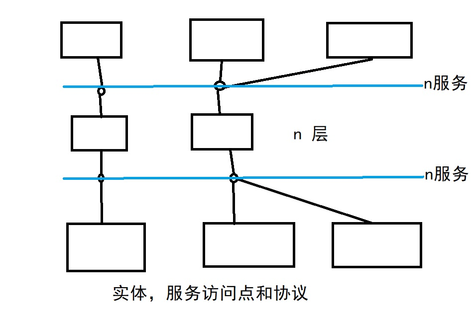
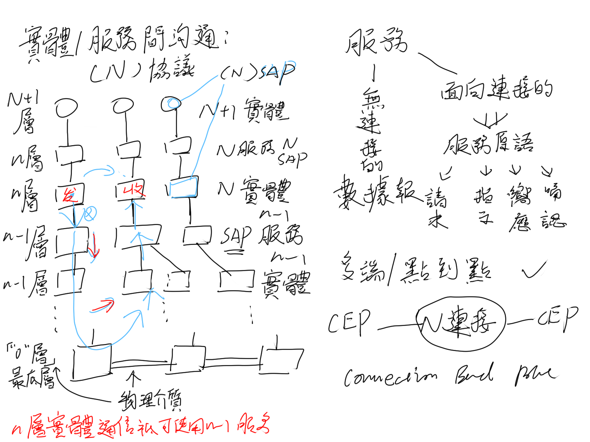
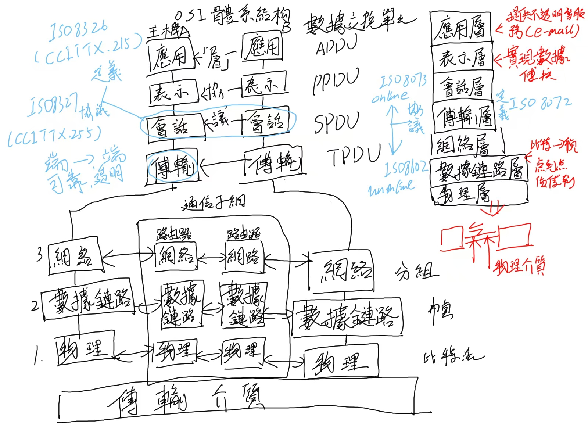
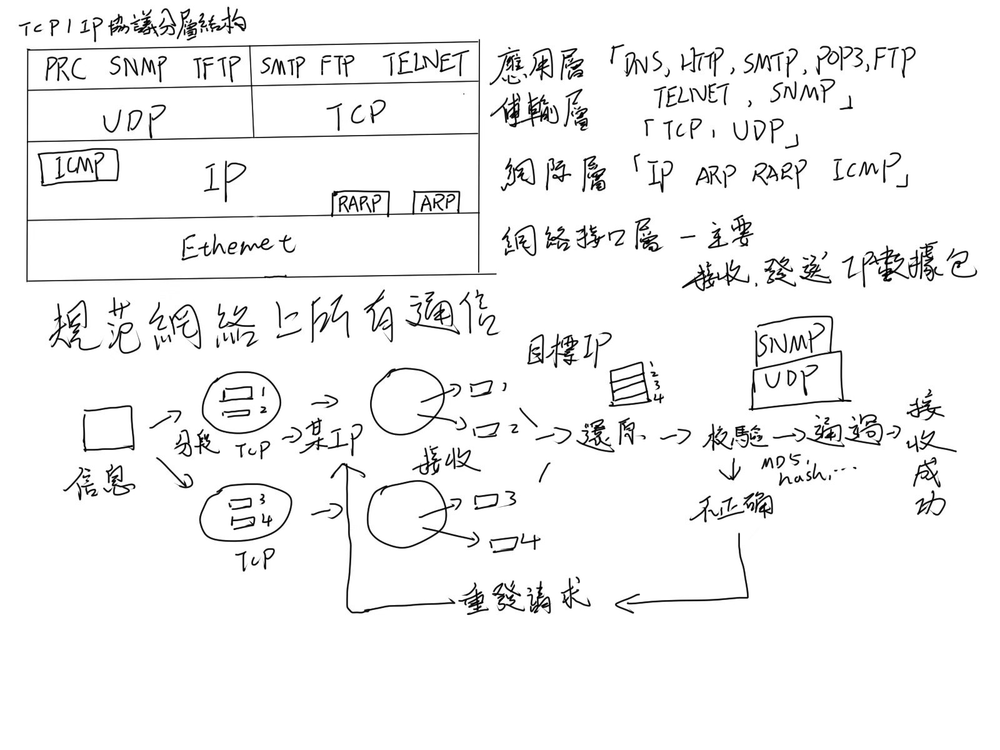

# 构成

计算机网络的组成元素可以分为两大类，即网络节点和通信链路 。 网络节点又分为端节点和转发节点 。端节点指信源和信宿节点，例如用户主机和用户终端 : 转发节点指网络通信过程中控制和转发信息的节点，例如交换机，集线器、接口信息处理机等 。 通信链路是指传输信息的信道，可以是电话线、同轴电缆、无线电线路、卫星线路、微波中继线路和光纤线缆等 。**通信子网中转发节点的互连模式叫作子网的拓扑结构**。在广域网中常见的互连拓扑是树型和不规则型，而在局域网中则常用星型，环型 、总线型等规则型拓扑结构。  
按照使用方式可以把计算机网络分为校园网( Campus Network)和企业网( Enterprise Network)，前者用于学校内部的教学科研信息的交换和共享，后者用于企业管理和办公自动化 。一个校园网或企业网可以由内联网( Intranet)和外联网( Extranet)组成 。 内联网是采用 Internet 技术( TCP/IP 协议和 B/S 结构)建立的校园网或企业网 ，用防火墙限制与外部的信息交换，以确保内部的信息安全。外联网是校园网或企业网的一部分，通过 Internet 上的安全通道与内部网进行通信。  
按照网络服务的范围可以把计算机网络分为公用网与专用网 。公用网是通信公司建立和经营的网络，向社会提供有偿的通信和信息服务。专用网一般是建立在公用网上的虚拟网络，仅限于一定范围的用户之间的通信，或者对一定范围的通信设备实施特殊的管理。  
按照提供的服务可以把计算机网络分为通信网和信息网。通信网提供远程联网服务，各种校园网和企业网通过远程连接形成 Internet，提供互连服务的供应商叫作 ISP ( Internet Service Provider)。信息网提供 Web 信息浏览 、 文件下载和电子邮件传送等信息服务 ， 提供网络信息服务的供应商叫作 ICP (Internet Content Provider)。

# 历史

国际标准化组织ISO于1978年提出了一个网络体系结构模型，叫做开放互联参考模型（OSI/RM），它为开放系统互连提供了一种功能结构框架，ISO7498文件对它做了详细的规定和描述。  
它是一种分层体系结构，从逻辑功能看，每一个开放系统都由一些连续之子系统组成，这些子系统处于各个开放系统和分层的交叉点上，一个层次由所有的互联系统同一行上的子系统组成

为叙述方便，将任意层称为n层，以此类推，上，下分别为n+1，n-1层。n层实体被称为“n实体”  

(N)实体之间通信只使用（N-1）服务，最底层实体之间通过OSI规定的物理介质通信，物理介质形成OSI体系中的（0）层。实体之间合作关系由（N）协议来规范。（N）协议是由公式和规则组成的集合。精准定义（N）实体如何协同工作，利用（N-1）服务去完成（N）功能，以便向（N+1）实体提供服务

（N+1）实体从（N）服务访问点（service accessing point 即sap）获取（N）服务。(N)SAP表示（N）实体与（N+1）实体之间得逻辑接口，一个（N）SAP只能由一个（N）实体所使用。一个（N）实体可以提供几个（N）SAP，一个（N+1）实体亦可利用几个（N）SAP为其服务

(N)SAP只代表(N)与(N+1)建立服务关系的手段

服务分为面向连接的服务和无连接的服务。对于面向连接的服务， 有 4种形式的服务原语， 即请求原语 、 指示原语、响应原语和确认原语 。 (N)层提供 (N) SAP 之间的连接，这种连接是(N)服务的组成部分。 通常的连接是点到点的连接。 但是也可以在多个端点之间建立连接， 多点连接和实际网络中的广播通信相对应。 (N)连接的两端叫作 (N) 连接端 点( Connection End Point, CEp， (N)实体用本地 的 CEP 来标识它建立的各个连接 。 另外，在网络服务中还有一种叫作数据报的无连接的通信， 它对面向事务处理的应用很重要， 所以后来也增添到 OSI/RM 中

# OSI体系结构

**物理层**的主要功能是在链路上透明地传输比特，包括线路配置、确定数据传输模式、确定信号形式、对信号进行编码、连接传输介质。为此定义了建立、维护和拆除物理链路所具备的机械特性、电气特性、功能特性以及规程特性。在物理层，OSI采用了各种现成的协议，其中有RS-232、RS-449、X.21、V.35、ISDN，以及FDDLIEEE 802.3、IEEE802.4和IEEE802.5 的物理层协议。**数据链路层**将比特组成帧，在链路上提供点到点的帧传输，并进行差错控制、流量控制等。在数据链路层，OSI的协议集也是采用了当前流行的协议，其中包括HDLC、LAP-B以及IEEE 802的数据链路层协议(ISO8802）。**网络层**在源节点和目的节点之间进行路由选择、拥塞控制、顺序控制、传送包，保证报文的正确性。OSI网络层又分成了3个子层，ISO8648文件描述了网络层内部的组织，给出了3个子层的协议。最上面的子层完成与子网无关的会聚功能（SNIC），相当于网际协议中间一个子层实现与子网相关的会聚功能（SNDC），它的作用是把一个具体的网络服务改造得适合于网络子层的需要：最下面的子层利用数据链路服务，实现子网访问功能（SNAC）。

**传输层**提供端到端的可靠的、透明的数据传输，保证报文顺序的正确性、数据的完整性。OSI传输服务定义文件是ISO8072，传输层协议规范文件是ISO8073 （连接模式）和ISO8602 （无连接模式）。**会话层**建立通信进程的逻辑名字与物理名字之间的联系，提供进程之间建立、管理和终止会话的方法，处理同步与恢复问题。会话层在传输层提供的完整的数据传送平台上提供应用进程之间组织和构造交互作用的机制，这种机制表现在会话层服务定义文件ISO8326 ( CCITT X.215）和协议规范文件ISO8327 ( CCITT X.225）中。**表示层**实现数据转换（包括格式转换、压缩、加密等），提供标准的应用接口、公用的通信服务、公共数据表示方法。**应用层**对用户提供不透明的各种服务，如E-mail。OSI模型比较完整，但也非常复杂。除了低3层有实现外，其余层次没有实现，现在己基本不用。

# TCP/IP协议

美国国防高级研究计划局（DARPA)1969年在研究ARPANET时提出了TCP/IP模型。和开放系统互连参考模型一样，TCP/IP协议是一个分层结构。协议的分层使得各层的任务和目的十分明确，这样有利于软件编写和通信控制。TCP/IP协议分为4层，由下至上分别是**网络接口层、网际层、传输层和应用层**，如图所示。

最上层是**应用层**，就是和用户打交道的部分，用户在应用层上进行操作，如收发电子邮件、文件传输等。也就是说，用户必须通过应用层才能表达出他的意愿，从而达到目的。其中，简单网络管理协议（SNMP）就是一个典型的应用层协议。应用层的主要协议有DNS、HTTP, SMTP、POP3、FTP、TELNET、SNMP。**传输层**的主要功能是对应用层传递过来的用户信息进行分段处理，然后在各段信息中加入一些附加的说明，如说明各段的顺序等，保证对方收到可靠的信息。该层有两个协议：一个是传输控制协议（TCP）：另一个是用户数据包协议（UDP), SNMP就是基于UDP协议的一个应用协议。传输层的主要协议有TCP,UDP。**网际层**将传输层形成的一段一段的信息打包成IP数据包，在报头中填入地址信息，然后选择好发送的路径。本层的网际协议(IP）和传输层的TCP是TCP/IP体系中两个最重要的协议。与IP协议配套使用的还有地址解析协议（ARP）、逆向地址解析协议（RARP）、Internet控制报文协议（ICMP）。**网络接口层**是最底层，也称链路层，其功能是接收和发送IP数据包，负责与网络中的传输媒介打交道。网络接口层一直没有明确地定义其功能、协议和实现方式。TCP/IP本质上采用的是分组交换技术，其基本意思是把信息分割成一个个不超过一定大小的信息包传送出去。分组交换技术的优点是：一方面可以避免单个用户长时间占用网络线路：另一方面是在传输出错时不必全部重新传送，只需要将出错的包重新传输就可以了。TCP/IP规范了网络上的所有通信，尤其是一个主机与另一个主机之间的数据往来格式以及传送方式。数据传送过程可以形象地理解为，TCP和IP就像两个信封，要传递的信息被划分成若干段，每一段塞入一个TCP信封，并在该信封上记录分段号信息，再将TCP信封塞入IP大信封，发送上网。在接收端，每个TCP软件包收集信封，抽出数据，按发送前的顺序还原，并加以校验，若发现差错，TCP将会要求重发。因此，TCP/IP在互联网中几乎可以无差错地传送数据。

最后一次编辑：2025/10/29 17：26
