# 数据编码

二进制数字信息在传输过程中可以采用不同的代码，各种代码的抗噪声特性和定时功能各不相同， 实现费用也不一样

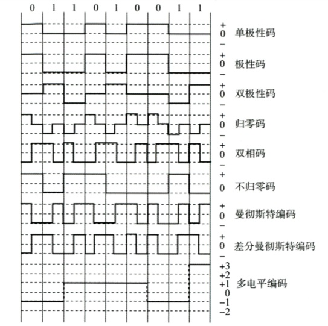

## 单极性码

在这种编码方案中，只用正的(或负的)电压表示数据。例如，在图 1-4 中用+3V 表示二进制数字 “0”，用0V表示二进制数字“1” 。单极性码用在电传打字机(TTY)接口以及PC 与 TTY 兼容的接口中 ，这种代码需要单独的时钟信号配合定时，否则，当传送一长串 0 或 l1时，发送机和接收机的时钟将无法定时，单极性码的抗噪声特性也不好。

## 极性码

在这种编码方案中，分别用正电压和负电压表示二进制数“0”和“ 1” 。 例如， 在图 1-4 中 用+3V表示二进制数字“0”， 用-3V表示二进制数字“1” 。这种代码的电平差比单极性码大， 因而抗干扰特性好，但仍然需要另外的时钟信号 。

## 双极性码

在双极性编码方案中 ， 信号在 3个电平(正、 负、 零)之间变化。一种典型的双极性码就是所谓的信号交替反转编码( Alternate Mark Inversion, AMI) 。在 AMI 信号中 ， 数据流中遇到“ 1”时使电平在正和负之间交替翻转 ， 而遇到“0”时则保持零电平 。 双极性是三进制信号编码方法，它与二进制编码相比抗噪声特性更好。 AMI有其内在的检错能力，当正负脉冲交替出现的规律被打乱时容易识别出来，这种情况叫 AMI 违例 。 这种编码方案的缺点是当传送长串 “0”时会失去位同步信息。对此稍加改进的一种方案是“ 6 零取代”双极性码 B6ZS，即把连续 6 个“0”用一组代码代替 。这一组代码中若含有 AMI 违例，便可以被接收机识别出来。

## 归零码

在归零码中 ，码元中间的信号回归到零电平 ，因此，任意两个码元之间被零电平隔开。与以上仅在码元之间有电平转换的编码方案相比 ，这种编码方案有更好的噪声抑制特性。因为噪声对电平的干扰比对电平转换的干扰要强，而这种编码方案是以识别电平转换边来判别 “0” 和“ 1” 信号的。图 1-4 中表示出的是一种双极性归零码。 可以看出，从正电平到零电平的转换边表示码元“0” ， 从负电平到零电平的转换边表示码元“ l”，同时每一位码元中间都有电平转换，使得这种编码成为自定时的编码 。

## 双相码

双相码要求每一位中都要有一个电平转换 。 因而这种代码的最大优点是自定时，同时双相码也有检测错误的功能，如果某一位中间缺少了电平翻转，则被认为是违例代码。

## 不归零码

图中所示的不归 零码的规律是当“ 1”出现时电平翻转，当“ 0”出现时电平不翻转 。 因而数据“ 1”和“0”的区别不是高低电平，而是电平是否转换。 这种代码也叫差分码，用在终端到调制解调器的接口中 。 这种编码的特点是实现起来简单 ，而且费用低，但不是自定时的。

## 曼彻斯特编码

曼彻斯特编码是一种双相码。在图中，用高电平到低电平的转换边表示 “0”，用低电平到高电平的转换边表示 “1”，相反的表示也是允许的。位中间的电平转换边既表示了数据代码，同时也作为定时信号使用 。曼彻斯特编码用在以太网中 。

## **差分曼彻斯特编码**

差分曼彻斯特编码也是一种双相码，和曼彻斯特编码不同的是，这种码元中间的电平转换边只作为定时信号，不表示数据。数据的表示在于每 一位开始处是否有电平转换，有电平转换表示“0”，无电平转换表示 “1” 。差分曼彻斯特编码用在令牌环网中。

从曼彻斯特编码和差分曼彻斯特编码的图形中可以看出 ，这两种双相码的每一个码元都要调制为两个不同的电平，因而调制速率是码元速率的两倍 。 这对信道的带宽提出了更高的要求，所以实现起来更困难 ，也更昂贵 。 但由于其良好的抗噪声特性和自定时功能，**在局域网中仍被广泛使用 。**

## 多电平编码

多电平编码的码元可取多个电平之一， 每个码元可代表几个二进制位。 例如，令 公式。若表示码元的脉冲取 4个电平之一，则一个码元可表示两个二进制位。 与双相码相反，多电平码的数据速率大于波特率，因而可提高频带的利用率。但是这种代码的抗噪声特性不好，在传输过程中信号容易畸变到无法区分。

在数据通信中，选择什么样的数据编码要根据传输的速度、信道的带宽、线路的质量以及实现的价格等因素综合考虑 。

**快速以太网标准 l00BASE-TX 采用的编码机制是多电平编码 MLT-3** 。 MLT-3 是 Multi-Level Transmit 的简称 ， 其中的 3 表示这种编码方式有 3 种状态 。 MLT-3 在多种文献中解释为多阶基带编码 3 或者三阶基带编码 。 就三阶而言 ， 信号通常区分成三种电位状态，分别为 “正电位”“负电位”“零电位” 。

MLT-3 的编码机制状态如图所示，具体规则如下 :

(1 )用不变化电位状态(即保持前一位的电位状态)来表示二进制 0，即如果下一 比特是 0, 则输出值与前面的值相同:

(2)用电位状态变化来表示二进制 1。 如果下一 比特是 1，则输出值就要有一个转变:如果前面输出的值是+V 或-V，则下一输出为 0:如果前面输出的值是 0，则下一输出的值为+V 或-V， 与上一个非0值符号相反。

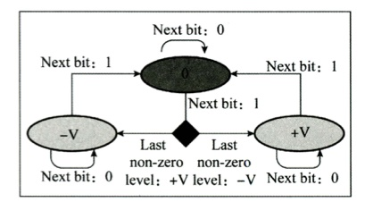

## **4B/5B 编码**

**快速以太网标准 l00BASE-FX 采用的编码机制是 4B/5B和 NRZ-I 编码**

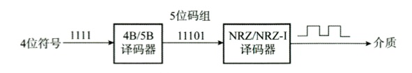

这实际上是一种两级编码方案。 系统中使用不归零码，在发送到传输介质之前要变成见 1就翻不归零码 NRZ-I 。 NRZ-I 代码序列中 1 的个数越多 ， 越能提供同步定时信息，但如果遇到长串的 0，则不能提供同步信息。 所以在发送到介质之前还需经过一次 4B/5B 编码， 发送器扫描要发送的位序列， 4位分为一组，然后按照表 1-1 的对应规则变换成 5 位的代码 。

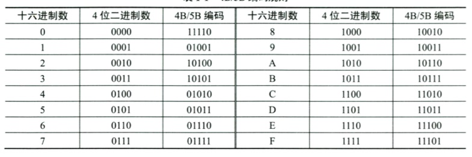

5位二进制代码的状态共有 32种，在表 1-1 中选用的 5位代码中 1的个数都不少于两个。 这就保证了在介质上传输的代码能提供足够多的同步信息。另外，还有 8B/10B 编码等方法， 其原理是类似的 。

## 8B/6T 编码

**快速以太网标准100BASE-T4采用的编码机制是 8B/6T编码**。 8B/6T 的编码方式为二进制输入按 8位分组，每一个 8位组映象为6位三元符号组，如图所示。

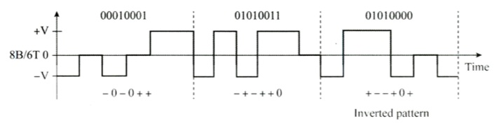

由于字码包含 6个符号，而每一个符号有 3 种电位(+、 0、 -)，因此所有可用的字码有 729 个 （公式）但是要代表所有 8位元的组合只要 256种字码即可 ($2^8=256$) 。 然后轮流在三个输出线对上发送输出，每个线对上的波特率为$25Mbaud$， 因为$25Mbaud÷/frac6 8 =33.333Mbps$, 所以总传输率 $100Mbps$。

## **4D-PAM5 编码**

**4D-PAM5这种编码方式用于 1000BASE-T以太网网络**。4D是指4个码元， 定义为(An,Bn, Cn,Dn)，也就是4维符号，比如说符号An是比特00，符号Bn是01， 符号Cn是10，符号 Dn是11。 PAM5的意思就是4维符号的电波形是一维5进制电平{2,1,0, 1,-2}， 每根网线的其中一个线对的电平有 5种， 多出来的一个电平用于前向纠错码 FEC。

1000BASE-T 以太网网络物理层上的定义为 : 1000BASE-T 使用 5 类双绞线( 8 根线 ， 4 个线对)，全双工基带传输。 1000BASE-T 的传输速率是$1000Mb/s$，通过 4个线对发送和接收，每个线对上基带信号的调制速率是$125Mb/s$， 一个码元要携带2个比特信息，每个线对的传输速率是$250Mb/s$， 具体实现如图所示。

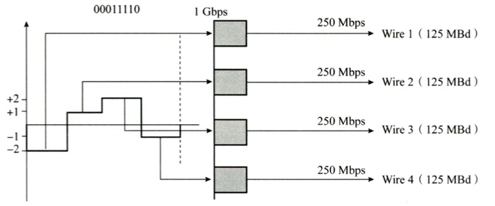

# 数字调制技术

数字数据不仅可以用方波脉冲传输 ，也可以用模拟信号传输 。 用数字数据调制模拟信号叫作数字调制 。本小节讲述简单的数字调制技术 。

可以调制模拟载波信号的 3 个参数 幅度、频率和相位， 来表示数字数据。 在电话系统中就是传输这种经过调制的模拟载波信号的 。 3 种基本模拟调制方式如图所示。

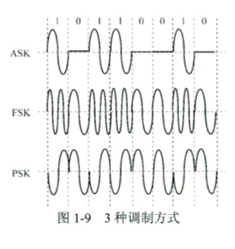

## 幅度键控 (ASK)

按照这种调制方式，载波的幅度受到数字数据的调制而取不同的值。例如，对应二进制“0”，载波振幅为 “0” :对应二进制“ 1”，载波振幅取“ 1” 。 调幅技术虽然实现起来简单 ,但抗干扰性能较差。

图

## 频移键控 (FSK)

按照数字数据的值调制载波的频率叫作频移键控 。例如对应二进制“ 0”的载波频率为 $f_1$,对应二进制进制“ 1”的载波频率为$f_2$。 这种调制技术的抗干扰性能好,但占用带宽较大.。在有些低速调制解调器中，用这种调制技术把数字数据变成模拟音频信号传送 。

## 相移键控 (PSK)

用数字数据的值调制载波相位，这就是相移键控。例如,用 180 相移表示“ 1” ;用 0 相移表示“ 0” 。 这种调制方式的抗干扰性能好,而且相位的变化也可以作为定时信息来同步发送机和接收机的时钟。码元只取两个相位值叫 2 相调制 ，码元可取 4 个相位值叫 4 相调制 。 4 相调制时，一个码元代表两位二进制数(如表所示)。采用 4 相或更多相的调制能提供较高的数据速率，但实现技术更复杂。

可见 ， 数字调制的结果是模拟信号的某个参量(幅度 、频率或相位）取离散值 。 这些值与传输的数字数据是对应的 ，这是数字调制与传统的模拟调制不同的地方 。

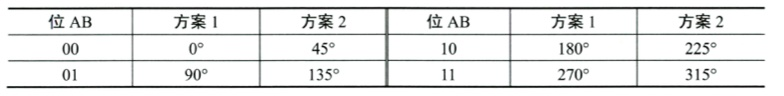

## 正交幅度调制

正交幅度调制( Quadrature Amplitude Modulation, QAM ) 就是把两个幅度相同但相位相差 90度的模拟信号合成为 一个模拟信号 。表中的例子是把 ASK 和 PSK 技术结合起来，形成幅度相位复合调制，这也是一种正交幅度调制技术。由于形成了 16 种不同的码元， 所以每一个码元可以表示4位二进制数据，使得数据速率大大提高 。

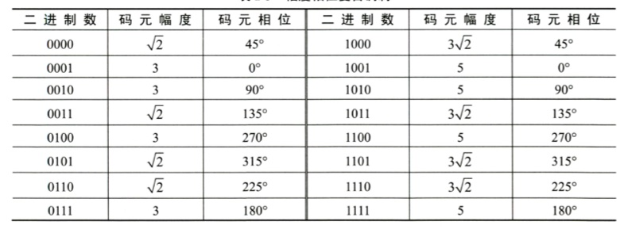

# 脉冲编码调制

模拟数据通过数字信道传输时效率高、失真小，而且可以开发新的通信业务。 例如， 在数字电话系统中可以提供语音信箱功能 。把模拟数据转化成数字信号 ， 要使用叫作编码解码器 (Codec)的设备。这种设备的作用和调制解调器的作用相反，它是把模拟数据(例如声音、 图像等)变换成数字信号 ，经传输到达接收端 ，再解码还原为模拟数据。用编码解码器把模拟数据变换为数字信号的过程叫模拟数据的数字化。常用的数字化技术就是脉冲编码调 制技术 (PulseCodeModulation, PCM) ， 简称脉码调制。

## 采样

每隔一定的时间 ， 取模拟信号的当前值作为样本 ， 该样本代表了模拟信号在某一时刻的瞬时值。 一系列连续的样本可用来代表模拟信号在某一区间随时间变化的值。以什么样的频率取样，才能得到近似于原信号的样本空间呢?奈奎斯特取样定理告诉我们 :如果取样速率大于模拟信号最高频率的两倍 ， 则可以用得到的样本空间恢复原来的模拟信号，即

$$
f=\frac 1 T > 2f_{max}
$$

其中，$f$为取样频率，$T$为取样周期，$f_{max}$为信号的最高频率

## 量化

量化
取样后得到的样本是连续值，这些样本必须量化为离散值，离散值的个数决定了量化的精度。在图中，把量化的等级分为 16 级，用 0000~1111 这 16个二进制数分别代表 0.1~1.6 这 16个不同的电平幅度。

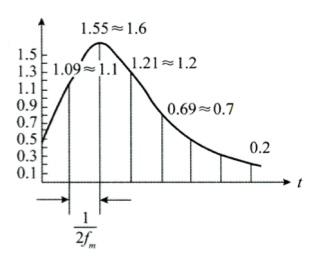

## 编码

把量化后的样本值变成相应的二进制代码，可以得到相应的二进制代码序列，其中每个二进制代码都可用一个脉冲串(4位)来表示， 这4位一组的脉冲序列就代表了经 PCM 编码的模拟信号。 由上述脉码调制的原理可以看出，取样的速率是由模拟信号的最高频率决定的，而量化级的多少则决定了取样的精度 。在实际使用中，希望取样的速率不要太高，以免编码解码器的工作频率太快;也希望量化的等级不要太多，能满足需要即可，以免得到的数据量太大 ，所以这些参数都取下限值。例如，对声音信号数字化时 ， 由于话音的最高频率是 4kHz，所以取样速率是 81Hz。 对话音样本用 128个等级量化，因而每个样本用7位二进制数字表示。在数字信道上传输这种数字化了的话音信号的速率是 $7×8000=56kbps$。 如果对电视信号数字化，由于视频信号的带宽更大( 6MHz)，取样速率就要求更高，假若量化等级更多，对数据速率的要求也就更高了。

# 通信方式和交换方式

## 同步传输与异步传输

在通信过程中，发送方和接收方必须在时间上保持同步才能准确地传送信息。前面曾提到过信号编码的同步作用，叫码元同步。另外，在传送由多个码元组成的字符以及由许多字符组成的数据块时，通信双方也要就信息的起止时间取得一致。这种同步作用有两种不同的方式，因而对应了两种不同的传输方式。

## 异步传输

即把各个字符分开传输，字符之间插入同步信息。 这种方式也叫起止式，即在字符的前后分别插入起始位( “0”)和停止位(“ 1” ) ， 如图所示 。起始位对接收方的时钟起置位作用。接收方时钟置位后只要在 8~ 11 位的传送时间内准确 ，就能正确接收一个字符。最后的停止位告诉接收方该字符传送结束 ，然后接收方就可以检测后续字符的起始位 了 。当没有字符传送时连续传送停止位 。

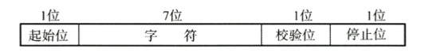

加入校验位的目的是检查传输中的错误 ， 一般使用奇偶校验。异步传输的优点是简单，但是由于起止位和检验位的加入会引入 20%~30%的开销，传输的速率也不会很高 。

## 同步传输

异步传输不适合于传送大的数据块(例如磁盘文件)
， 同步传输在传送连续的数据块时比异步传输更有效。按照这种方式，发送方在发送数据之前先发送一 串同步字符 SYNC，接收方只要检测到连续两个以上 SYNC 字符就确认己进入同步状态，准备接收信息。随后的传送过程中，双方以同一频率工作(信号编码的定时作用也表现在这里) ，直到传送完指示数据结束的控制字符。这种同步方式仅在数据块的前后加入控制字符 SYNC， 所以效率更高。在短距离高速数据传输中 ， 多采用同步传输方式 。

## 交换方式

一个通信网络由许多交换节点互连而成。信息在这样的网络中传输就像火车在铁路网络中运行一样，经过一系列交换节点(车站 )，从一条线路交换到另 一条线路，最后才能到达目的地。交换节点转发信息的方式可分为**电路交换，报文交换和分组交换**3种。

电路交换把发送方和接收方用一系列链路直接连通。电话交换系统采用 的就是这种交换方式。当交换机收到一个呼叫后就在网络中寻找一条临时通路供两端的用户通话， 这条临时通路可能要经过若干个交换机的接， 并且一旦建立连接就成为这一对用户之间的临时专用通路，其他用户不能打断，直到通话结束才拆除连接。

电路交换的特点是建立连接需要等待较长的时间。由于连接建立后通路是专用的，因而不会有其他用户的干扰，不再有等待延迟。这种交换方式适合于传输大量的数据，传输少量信息时效率不高。

报文交换不要求在两个通信节点之间建立专用通路。节点把要发送的信息组织成一个数据包(报文) ，该报文中含有目标节点的地址，完整的报文在网络中一站一站地向前传送。每一 个节点接收整个报文，检查目标节点地址， 然后根据网络中 的 “交通情况” 在适当的时候转发 到下一个节点。经过多次存储一转发 ， 最后到达目标节点，因而这样的网络叫存储一转发网络。

分组交换中数据包有固定的长度，因而交换节点只要在 内存中开辟一个小的 缓冲区就可以 了。在进行分组交换时， 发送节点要先对传送的信息分组，对各个分组编号，加上源地址和目 标地址以及约定的分组头信息，这个过程叫作信息的打包。 一次通信中的所有分组在网络中传播又有两种方式: 一种叫数据报 (Datagram) ， 另一种叫虚电( VirtualCircuit)。

(1)数据报。类似于报文交换 ， 每个分组在网络中的传播路径完全是由网络当时的状况随机决定的。因为每个分组都有完整的地址信息， 如果不出意外都可以到达目的地。 但是，到达目的地的顺序可能和发送的顺序不一致。有些早发的分组可能在中间某段交通拥挤的链路上耽搁 了,比后发的分组到得迟,目标主机必须对收到的分组重新排序才能恢复原来的信息 。一般来说,在发送端要有一个设备对信息进行分组和编号,在接收端也要有一个设备对收到的分组 拆去头,尾井重排顺序， 具有这些功能的设备叫分组装拆设备(PacketAssembly/ Disassembly, PAD) ， 通信双方各有一个。

(2)虚电路。类似于电路交换,这种方式要求在发送端和接收端之间建立一条逻辑连接。 在会话开始时， 发送端先发送建立连接的请求消息， 这个请求消息在网络中传播， 途中的各个交换节点根据当时的交通状况决定取哪条线路来响应这一请求 ， 最后到达目的端。如果目的端给予肯定的回答，则逻辑连接就建立了。以后发送端发出的一系列分组都走这一条通路，直到会话结束，拆除连接。与电路交换不同的是 ， 逻辑连接的建立并不意味着其他通信不能使用这条线路 ， 它仍然具有链路共享的优点。

# 多路复用技术

多路复用技术是把多个低速信道组合成一个高速信道的技术。这种技术要用到两个设备 ， 其中 ，**多路复用器( Multiplexer)在发送端根据某种约定的规则把多个低带宽的信号复合成一个高带宽的信号: 多路分配器( Demultiplexer)在接收端根据同一规则把高带宽信号分解成多个低带宽信号 。 多路复用器和 多路分配器统称为多路器，简写为 MUX**， 多路复用的过程如图所示。

只要带宽允许，在己有的高速线路上采用多路复用技术可以省去安装新线路的大笔费用，因而现今的公共交换 电话网( PSTN) 都使用这种技术 ， 有效地利用了高速干线的通信能力。

当然，也可以相反地使用多路复用技术，即把一个高带宽的信号分解到几个低速线路上同时传输， 然后在接收端合成为原来的高带宽信号。例如， 两个主机可以通过若干条低速线路连接以满足主机间高速通信的要求 。

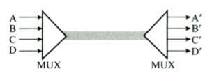

## 频分多路复用

频分多路复用( Frequency Division Multiplexing, FDM )是在一条传输介质上使用多个频率不同的模拟载波信号进行多路传输， 这些载波可以进行任何方式的调制，如 ASK、 FSK、 PSK 以及它们的组合。每一个载波信号形成了一个子信道，各个子信道的中心频率不相重合，子信道之间留有一定宽度的隔离频带，如图所示。 频分多路技术早已用在无线电广播系统中， 在有线电视系统(CATV) 中也使用频分多路技术。一根 CATV 电缆的带宽大约是 1000MHz， 可传送多个频道的电视节目，每个频道 6.5MHz 的带宽中又划分为声音子通道、 视频子通道以及彩色子通道。 每个频道两边都留有一定的警戒频带，防止相互串扰。 FDM 也用在宽带局域网中。电缆带宽至少要划分为不同方向上的两个子频带， 甚至还可以分出一定带宽用于某些工作站之间的专用连接。 时分多路复用
时分多路复用(Time Division Multiplexing， TDM)要求各个子通道按时间片轮流地占用整个带宽，时间片的大小可以按一次传送一位、 一个字节或一个固定大小的数 据块所需的时间来确定 。

## 时分多路复用

可以用在宽带系统中，也可以用在频分制下的某个子通道上。 时分制按照子 通道的动态利用情况又可分为两种，即同步时分和统计时分 。 在同步时分制下，整个传输时间 被划分为固定大小的周期。每个周期内， 各子通道都在固定位置占有一个时槽。 这样，在接收端可以按约定的时间关系恢复各子通道的信息流。当某个子通道的时槽来到时，如果没有信息 要传送，这一部分带宽就浪费了。统计时分制是对同步时分制的改进，特别把统计时分制下的 多路复用器称为集中器，以强调它的工作特点。在发送端 ， 集中器依次循环扫描各个子通道， 若某个子通道有信息要发送，则为它分配一个时槽，若没有就跳过 ， 这样就没有空槽在线路上传 播了 。 然而，需要在每个时槽加入一个控制字段，以便接收端可以确定该时槽是属于哪个子通道的。

## 波分多路复用

波分多路复用(WavelengthDivisionMultiplexing,WDM)使用在光纤通信中， 不同的子信道用不同波长的光波承载 ，多路复用信道同时传送所有子信道的波长 。这种技术在网络中要使用能够对光波进行分解和合成的多路器 ， 如图所示 。

# 扩频技术

为了提高通信系统的抗干扰性能 ，往往需要从调制和编码多方面入手，改进通信质量 ，扩频通信就是方法之一。由于扩频通信利用了扩展频谱技术，在接收端对干扰频谱能量加以扩散，对信号频谱能量压缩集中，因此在输出端就得到了信噪比的增益 。

扩频通信是指系统占用的频带宽度远大于要传输的原始信号的带宽(或信息比特率 )，且与原始信号带宽无关。通常规定: 如果信息带宽为$B$，扩频信号带宽为$f_  {ss}$,则扩频信号带宽与信息带宽之比$\frac {f_{ss}}  {B}$称为扩频因子 。

当$\frac {f_{ss}}  {B} =1 \sim 2$，即射频信号带宽略大于信息带宽时 ， 称为窄带通信 :

当$\frac {f_{ss}}  {B} \geq 50$，即射频信号带宽大于信息带宽时,称为宽带通信:

当$\frac {f_{ss}}  {B} \geq 100$，即射频信号带宽远大于信息带宽时，称为扩频通信。 扩频通信系统可以分为以下几种基本形式 。

## 直接序列扩频

直接序列扩频( Direct Sequence Spread, DSSS)方式中 ，要传送的信息经伪随机序列编码 后对载波进行调制。 在发送端直接用扩频码序列去扩展信号的频谱，在接收端，用相同的扩频 码序列进行解扩,将展宽的频谱扩展信号还原成原始信号，如图所示 。 因为伪随机序列的速率远大于要传送信息的速率 ，所以受调信号的频谱宽度将远大于要传送信息的频谱宽度。

## 跳频

在跳频(FrequencyHopping, FH)方式中，载波信息的信号频率受伪随机序列的控制，快 速地在一个频段中跳变，此跳变的频段范围远大于要传送信息所占的频谱宽度。

只要收、发信双方保证时·频域上的调频顺序一致 ， 就能确保双方的可靠通信。在每一个跳频时间的瞬时， 用户所占用的信道带宽是窄带频谱，随着时间的变换， 一系列的瞬时窄带频谱在一 个很宽的频带内跳变，形成一个很宽的调频带宽 。

## 跳时

在跳时(TimeHopping, TH) 方式中， 把每个信息码元划分成若干个时隙，此信息受伪随 机序列的控制， 以突发的方式随机地占用其中一个时隙进行传输。 因为信号在时域中压缩其传 输时间，相应地在频域中 要扩展其频谱宽度 。

## 线性调频扩频

线性调频扩频 CChirp Spread Spectrum, CSS)是指在给定脉冲持续间隔内，系统的载频线 性地扫过一个很宽的频带。 因为频率在较宽的频带内变化， 所以信号的带宽被展宽。

# 差错控制

通信过程中出现的差错可大致分为两类: 一类是由热噪声引起的随机错误;另一类是由冲 击噪声引起的突发错误 。

通信线路中的热噪声是由电子的热运动产生的，香农关于噪声信道传输速率的结论就是针 对这种噪声的。 热噪声时刻存在， 具有很宽的频谱， 且幅度较小。 通信线路的信噪比越高，热 噪声引起的差错越少。 这种差错具有随机性， 影响个别位。冲击噪声源是外界的电磁干扰。 例 如，打雷闪电时产生的电磁干扰， 电焊机引起的电压波动等。 冲击噪声持续的时间短而幅度大， 往往引起一个位串出错。 根据它的特点， 称其为突发性差错。

此外 ， 由于信号幅度和传播速率与相位、频率有关而引起的信号失真，以及相邻线路之间 发生串音等都会产生差错 ， 这些差错也具有突发性的特点 。

## 检错与纠错

在数据传输过程中 ， 由于信道受到噪声或干扰的影响 ， 信号 的波形传到接收方就可能会发 生错误。为了把这些错误减少到人们预期要求的最低限度 ， 就需要进行差错控制 。

差错控制的原理很简单。 在被传送的 k位信息后附加 r位冗余位，被传送的数据共 k+r位，而这 r位冗余位是用某种明确定义的算法直接从 k位信息导出的，接收方对收到的信息应用同一算法，将结果与发送方给它的结果进行比较，若不相等则数据出现了差错。 如果接收方知道有差错发生，但不知道是怎样的差错，然后向发送方请求重传，这种策略称为检错。 如果接收方知道有差错发生，而且知道是怎样的差错，这种策略称为纠错 。

## 海明码

1950年，海明(Hamming)研究了用冗余数据位来检测和纠正代码差错的理论和方法。 按 照海明的理论，可以在数据代码上添加若干冗余位组成码字。 码字之间的海明距离是一个码字 要变成另一个码字时必须改变的最小位数。 例如， 7位 ASCII码增加一位奇偶位成为8位的码 字 ，这 128 个 8 位的码字之间的海明距离是 2。 所以，当其中 一位出错时便能检测出来 。 两位 出错时就变成另外一个码字 了 。

海明用数学分析的方法说明了海明距离的几何意义， n 位的码字可以用 n 维空 间的超立方体的一个顶点来表示。 两个码字之间的海明距离就是超立方体的两个对应顶点之间的一条边，而且这是两个顶点(两个码字)之间的最短距离，出错的位数小于这个距离都可以被判断为就近的码 字。 这就是海明码纠错的原理，它用码位的增加(因而通信量增加)来换取正确率的提高 。

按照海明的理论，纠错码的编码就是要把所有合法的码字尽量安排在n维超立方体的顶点上使得任意一对码字之间的距离尽可能大。 如果任意两个码字之间的海明距离是 d，则所有小于等于$d-1$位的错误都可以检查出来，所有小于$d/2$位的错误都可以纠正 。 一个自然的推论是，对于某种长度的错误串,要纠正它就要用比仅仅检测它多 一倍的元余位 。

如果对于 m 位的数据增加 k位冗余位，则组成 $n=m+k$ 位的纠错码 。 对于 $2m$个有效码字中的每一个，都有n个无效但可以纠错的码字。这些可纠错的码字与有效码字的距离是1,含单个错误位。这样，对于一个有效的消息总共有$n+1$个可识别的码字 。 这$n+1$个码字相对于其他$2m-1$个有效消息的距离都大于1。这意味着总共有$2m(n+1)$个有效的或者可纠锚的码字.显然,这个数应运码字的所有可能的个数,即 $2n$。于是，有

$$
2^m(n+1)\leq2^n
$$

对于给定的数据位m， 上式给出了k的下界，即要纠正单个错误， k必须取的最小值。 海明建议了一种方案可以达到这个下界，并能直接指出错在哪一位。首先把码字的位从1到n编号,并把这个编号表示成二进制数，即2的幂之和 。 然后对2的每一个幂设置一个奇偶位。例如，对于6号位，由于6=110 (二进制) ，所以 6 号位参加第 2 位和第 4 位的奇偶校验，而不参加第1位的奇偶校验。类似地，9号位参加第 l 位和第 8位的校验而不参加第 2位或第 4位的校验 。 海明把奇偶校验分配在1、 2、 4、 8 等位置上，其他位放置数据 。 下面根据图举例说明编码的方法

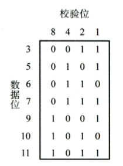

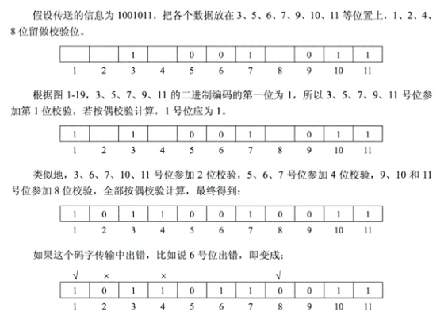

当接收端按照同样的规则计算奇偶位时,发现1和 8 号位的奇偶性正确,2 和 4 号位的奇偶性不对,于是 $2+4=6$，立即可确认错在6号位。

在上例中,$k=4$， 因而$m<2^4-4-1=11$，即数据位可用到11位，共组成15位的码字，可检测出单个位的错误。

## 循环冗余校验码

循环码是这样一组代码，其中任一有效码字经过循环移位后得到的码字仍然是有效码字，不论是右移或左移，也不论移多少位。例如，若($α_{n-1}a_{n-2},...a_1a_0)$是有效码字，则$(a_{n-2}a_{n-3}...a_0a_{n-1})  , (α_{n-3}α{n-4}...a_{n-1}a_{n-2}$)等都是有效码字。循环冗余校验码(Cyclic Redundancy Check,CRC)是一种循环码，它有很强的检错能力，而且，容易用硬件实现，在局域网中有广泛应用。

首先介绍CRC怎样实现，然后对它进行一些数学分析，最后说明CRC的检错能力。CRC可以用图所示的移位寄存器实现。移位寄存器由k位组成，还有儿个异或门和一条反馈回路。图所示的移位寄存器可以按CRC-CCITT标准生成16位的校验和。寄存器被初始化为0，数据从右向左逐位输入。当一位从最左边移出寄存器时就通过反馈回路进入异或门和后续进来的位以及左移的位进行异或运算。当所有m位数据从右边输入完后再输入k个0(本例中k=16)。最后，当这一过程结束时，移位寄存器中就形成了校验和。k位的校验和跟在数据位后边发送，接收端可以按同样的过程计算校验和并与接收到的校验和比较，以检测传输中的差错。

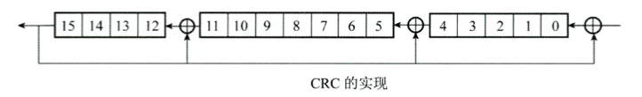

以上描述的计算校验和方法可以用一种特殊的多项式除法进行分析。m个数据位可以看作m-1阶多项式的系数。例如，数据码字00101011可以组成的多项式是$x_5+x_3+x+1$。图中表示的反馈回路可表示成另外一个多项式$x_16+x_12+x_5+1$，这就是所谓的生成多项式。所有的运算都按模2进行，即

$$
1x^a+1x^a=0x^a,0x^a+1x^a=1,1x^a+0x^a=1x^a,0x^a+0x^a=0x^a,-1x^a=1x^a
$$

显然，在这种代数系统中，加法和减法一样，都是异或运算。用x乘一个多项式等于把多项式的系数左移一位。可以看出，按反馈回路把一个向左移出寄存器的数据位反馈回去与寄存器中的数据进行异或运算，等同于在数据多项式上加上生成多项式，因而也等同于从

数据多项式中减去生成多项式。以上给出的例子，

对应于下面的长除法:

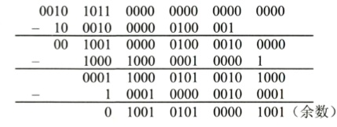

得到的校验和是9509H。于是看到，移位寄存器中的过程和以上长除法在原理上是相同的，因而可以用多项式理论来分析CRC代码，这就使得这种检错码有了严格的数学基础。把数据码字形成的多项式叫作数据多项式 $D(x)$ ，按照一定的要求可给出生成多项式$G(x)$。用$G(x)$除$x_kD(x)$可得到商多项式$Q(x)$和余多项式$R(x)$，实际传送的码字多项式是，

$$
F(x)=x^kD(x)+R(x)
$$

由于使用了模2算术，$+R(x)=-R(x)$，于是接收端对$F(x)$计算的校验和应为0。如果有差错，则接收到的码字多项式包含某些出错位E，可表示成

$$
H(x)=F(x)=E(x)
$$

由于$F(x)$可以被$G(x)$整除，如果$H(x)$不能被$G(x)$整除，则说明$E(x)0$，即有错误出现。然而，若$E(x)$也能被$G(x)$整除，则有差错而检测不到。数学分析表明，$G(x)$应该有某些简单的特性，才能检测出各种错误。例如，若$G(x)$包含的项数大于1，则可以检测单个错:若$G(x)$含有因子$x+1$，则可检测出所有奇数个错。最后得出的最重要的结论是:具有$r$个校验位的多项式能检测出所有长度小于等于$r$的突发性差错。为了能对不同场合下的各种错误模式进行校验，己经研究出了几种CRC生成多项式的国际标准。

CRC-CCITT $G(x)=x^{16}+x^{12}+x^5+1$

CRC-16 $G(x)=x^{16}+x^{15}+x^2+1$

CRC-12 $G(x)=x^{12}+x^{11}+x^3+x^2+x+1$

CRC-32 $G(x)=x^{32}+x^{26}+x^{23}+x^{22}+x^{16}+x^{12}+x^{11}+x^{10}+x^8+x^7+x^5+x^4+x^2+x+1$

其中，CRC-32被用在许多局域网中。
