# 局域网

## HDLC协议

HDLC(HighLevelDataLinkControl，高级数据链路控制)协议是国际标准化组织根据IBM公司的SDLC(SynchronousDataLinkControl，同步数据链路控制)协议扩充开发而成的。美国国家标准学会(ANSI)则根据SDLC开发出类似的协议，叫作ADCCP协(AdvancedDataCommunicationControlProcedure，高级数据通信控制协议)。

### 1.HDLC的基本配置

HDLC定义了3种类型的站、两种链路配置和3种数据传输方式。3种站分别如下:

(1)**主站**。对链路进行控制，主站发出的帧叫命令帧。

(2)**从站**。在主站控制下进行操作，从站发出的帧叫响应帧。

(3)**复合站**。具有主站和从站的双重功能。复合站既可以发送命令帧也可以发出响应帧。

两种链路配置如下:

(1)**不平衡配置**。适用于点对点和点对多点链路。这种链路由一个主站和一个或多个从站组成，支持全双工或半双工传输。

(2)**平衡配置**。仅用于点对点链路。这种配置由两个复合站组成，支持全双工或半双工传输。

3种数据传输方式如下:

**正常响应方式**(NormalResponseMode，NRM)。适用于不平衡配置，只有主站能启动数据传输过程，从站收到主站的询问命令时才能发送数据。

**异步平衡方式**(AsynchronousBalancedMode,ABM)。适用于平衡配置，任何一个复合站都无须取得另一个复合站的允许就可以启动数据传输过程.

**异步响应方式**(AsynchronousResponseMode,ARM)。适用于不平衡配置，从站无须取得主站的明确指示就可以启动数据传输，主站的责任只是对线路进行管理。正常响应方式可用于计算机和多个终端相连的多点线路上，计算机对各个终端进行轮询以实现数据输入。正常响应方式也可以用于点对点的链路上，例如计算机和一个外设相连的情况。异步平衡方式能有效地利用点对点全双工链路的带宽，因为这种方式没有轮询的开销。异步响应方式的特点是各个从站轮流询问中心站，这种传输方式很少使用。

### 2.HDLC的帧结构

HDLC使用统一的帧结构进行同步传输，图所示为HDLC的帧结构。从图中可以看出，HDLC帧由6个字段组成。以两端的标志字段(F)作为帧的边界，在信息字段(INFO)中包含了要传输的数据。

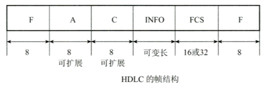

下面对HDLC帧的各个字段分别予以解释。

(1)**帧标志F**。HDLC用一种特殊的位模式。01111110作为帧的边界标志。链路上所有的站都在不断地探索标志模式，一旦得到一个标志就开始接收帧。在接收帧的过程中如果发现一个标志，则认为该帧结束了。由于帧中间出现位模式01111110时也会被当作标志，从而破坏了帧的同步，所以要使用位填充技术。发送站的数据位序列中一旦发现0后有5个1，则在第7位插入一个0，这样就保证了传输的数据中不会出现与帧标志相同的位模式。接收站则进行相反的操作:在接收的位序列中如果发现0后有5个1，则检查第7位，若第7位为0则删除;若第7位是1且第8位是0，则认为是检测到帧尾的标志:若第7位和第8位都是1，则认为是发送站的停止信号。有了位填充技术，任意的位模式都可以出现在数据帧中，这个特点叫作透明的数据传输。

(2)**地址字段A**。地址字段用于标识从站的地址，用在点对多点链路中。地址通常是8位长，然而经过协商之后，也可以采用更长的扩展地址。扩展的地址字段如图所示，可以看出，它是8位组的整数倍。每一个8位组的最低位表示该8位组是否是地址宇段的结尾:若为1，表示是最后的8位组:若为0，则不是。所有8位组的其余7位组成了整个扩展地址字段。全为1的8位组(11111111)表示广播地址。

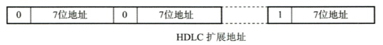

(3)**控制字段C**。HDLC定义了3种帧，可根据控制宇段的格式区分。信息帧(I帧)承载着要传送的数据，此外还捎带着流量控制和差错控制的应答信号。管理帧cs帧)用于提供ARQ控制信息，当不使用捎带机制时要用管理帧控制传输过程。无编号帧cu帧)提供建立、释放等链路控制功能，以及少量信息的无连接传送功能。控制字段第1位或前两位用于区别3种不同格式的帧，如图所示。基本的控制字段是8位长，扩展的控制字段为16位长。

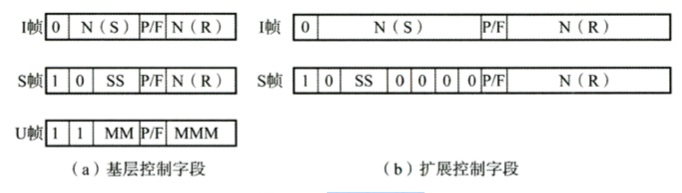

(4)**信息字段剧FO**。只有I帧和某些无编号帧含有信息宇段。这个字段可含有用于表示用户数据的任何序列，其长度没有规定，但具体的实现往往限定了最大帧长。

(5)**帧校验序列F**CSaFCS中含有各个字段的校验(标志字段除外)。通常使用CRC-CCITT标准产生16位校验序列，有时也使用CRC-32产生32位校验序列。

3.HDLC的帧类型
HDLC协议的帧类型如表所示。

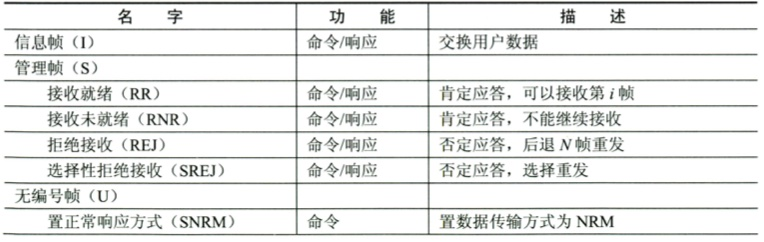

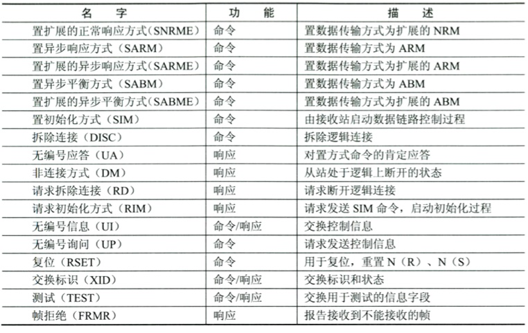

下面结合HDLC的操作介绍这些帧的作用。

(1)**信息帧**。信息帧除承载用户数据之外还包含该帧的编号NC韵，以及捎带的肯定应答顺序号NCR)。I帧还包含一个P/F位，在主站发出的命令帧中这一位表示P,ElP轮询(Polling);在从站发出的响应帧中这一位是F位，即终止位(Final)。在正常响应方式下，主站发出的I格式命令帧中的P/F位置1，表示该帧是询问帧，允许从站发送数据。从站响应主站的询问，可以发送多个响应帧，其中仅最后一个响应帧的P/F位置l，表示一批数据发送完毕。在异步响应方式和异步平衡方式下，P/F位用于控制S帧和U帧的交换过程。

(2)**管理帧**。管理帧用于进行流量和差错控制，当没有足够多的信息帧捎带管理命令/响应时，要发送专门的管理帧来实现控制。从表1-4看出，有4种管理帧可以用控制字段中的两个S位来区分。RR帧表示接收就绪，它既是对NCR)之前帧的确认，也是准备接收NCR)及其后续帧的肯定应答。时-l’R帧表示接收未就绪，在对NCR)之前的帧给予肯定应答的同时，拒绝进一步接收后续帧。REJ帧表示拒绝接收NCR)帧，要求重发NCR)帧及其后续帧。显然，REJ用于后退N帧ARQ流控方案中。类似地，SREJ帧用于选择重发ARQ流控方案中。

管理帧中P/F位的作用如下所述:主站发送P位置1的阻帧询问从站，是否有数据要发送。如果从站有数据要发送，则以信息、帧响应;否则从站以F位置1的阻帧响应，表示没有数据可发送。另外，主站也可以发送P位置l的RNR帧询问从站的状态。如果从站可以接收信息帧，则以F位置l的阻帧响应:反之，如果从站忙，则以F位置1的RNR帧响应。

(3)**无编号帧**。无编号帧用于链路控制。这类帧不包含编号字段，也不改变信息帧流动的顺序。无编号帧按其控制功能可分为以下几个子类:

• 设置数据传输方式的命令和响应帧。

• 传输信息的命令和响应帧。

• 用于链路恢复的命令和响应帧。

其它命令和相应帧
设置数据传输方式的命令由主站发送给从站，表示设置或改变数据传输方式。SARM和SABM分别对应3种数据传输方式。SNRME、SARME和SABME也是设置数据传输方式的命令帧，然而这3种传输方式使用两个字节的控制域。从站接收了设置传输方式的命令帧后以无编号应答帧CUA)响应。一种传输方式建立后一直保持有效，直到另外的设置方式命令改变了当前的传输方式。主站向从站发送置初始化方式命令(SIM)，使得接收该命令的从站启动一个建立链路的过程。在初始化方式下，两个站用无编号信息帧(UI)交换数据和命令。拆除连接命令(DISC)用于通知对方链路已经释放，对方站以UA帧响应，链路随之断开。
除UA帧之外，还有儿种响应帧与传输方式的设置有关。非连接方式帧(DM)可用于晌应所有的置传输方式命令，表示响应的站处于逻辑上断开的状态，即拒绝建立指定的传输方式。请求初始化方式帧CRIM)也可用于响应置传输方式命令，表示响应站没有准备好接收命令，或正在进行初始化。请求拆除连接帧(RD)则表示响应站要求断开逻辑连接。信息传输的命令和响应用于两个站之间交换信息。无编号信息帧CUI)既可作为命令帧，也可作为响应帧。UI帧传送的信息可以是高层的状态、操作中断状态、时间、链路初始化参数等。主站/复合站可发送无编号询问命令CUP)请求接收站送回无编号响应帧，以了解它的状态。
链路恢复命令和响应用于ARQ机制不能正常工作的情况下。接收站可用帧拒绝响应(FRMR)表示接收的帧中有错误。例如，控制宇段无效、信息字段太长、帧类型不允许携带信息以及捎带的NCR)无效等。
复位命令CRSET)表示发送站正在重新设置发送顺序号，这时接收站也应该重新设置接收顺序号。
还有两种命令和响应不能归入以上几类。交换标识CXID)帧用于在两个站之间交换它们的标识和特征，实际交换的信息依赖于具体的实现。测试命令帧(TEST)用于测试链路和接收站是否正常工作。接收站收到测试命令后要尽快以测试帧响应。
4.HDLC的操作
下面通过图1-24的例子说明HDLC的操作过程，这些例子虽然不能囊括实际运作中的所有情况，但是可以帮助读者理解各种命令和响应的使用方法。由于HDLC定义的命令和响应非常多，可以实现各种应用环境的所有要求，所以对于任何一种特定的应用，只要实现一个子集就可以了，以下给出的例子都是实际应用中的典型情况。

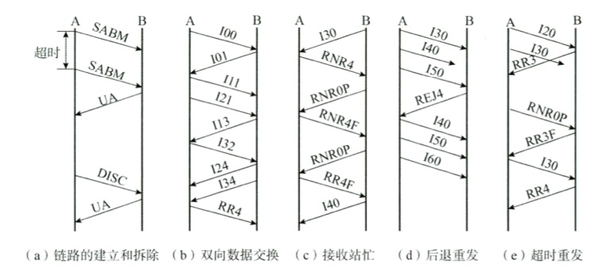

在图中，用I表示信息帧，I后面的两个数字分别表示信息帧中的N(S)和N®值。管理帧和无编号帧都直接给出帧名字，管理帧后的数字则表示帧中的N®值，P和F表示该帧中的P/F位置l，没有P和F表示这一位置0。  
**图(a)** 说明了链路建立和拆除的过程。A站发出SABM命令井启动定时器，在一定的时间内没有得到应答后重发同一命令。B站以UA帧响应，并对本站的局部变量和计数器进行初始化。A站收到应答后也对本站的局部变量和计数器进行初始化，并停止计时，这时逻辑链路就建立起来了。拆除链路的过程由双方交换一对命令DISC和响应UA完成。在实际使用中可能出现链路不能建立的情况，B站以DM响应A站的SABM命令，或者A站重复发送SABM命令预定的次数后放弃建立连接，向上层实体报告链接失败。

**图(b)** 说明了全双工交换信息帧的过程。每个信息帧中用N(S)指明发送顺序号，用N®指明接收顺序号。当一个站连续发送了若干帧而没有收到对方发来的信息帧时，N®字段只能简单地重复。例如，A发给B的111和121。最后A站没有信息帧要发时用一个管理帧RR4对B站给予应答。图中也表示出了肯定应答的积累效应。例如A站发出的RR4帧一次应答了B站的两个数据帧。

**图©** 画出了接收站忙的情况。出现这种情况的原因可能是接收站数据链路层缓冲区溢出，也可能是接收站上层实体来不及处理接收到的数据。图中A站以RNR4响应B站的130帧，表示A站对第3帧之前的帧己正确接收，但不能继续接收下一个帧。B站接收到RNR4后每隔一定时间以P位置l的RNR命令询问接收站的状态。接收站A如果保持忙则以F位置l的RNR帧响应:如果忙状态解除，则以F位置l的RR帧响应，于是数据传送从RR应答中的接收序号恢复发送。

**图(d)** 描述了使用REJ命令的例子。A站发出了第3、4、5信息帧，其中第4帧出错。接收站检出错误帧后发出REJ4命令，发送站返回到出错帧重发。这是使用后退N帧ARQ技术的典型情况。

**图(e)** 表示的是超时重发的例子。A站发出的第3帧出错，B站检测到错误后丢弃了它。但是，B站不能发出REJ命令，因为B站无法判断这是一个I帧。A站超时后发出P位置l的时RNR命令询问B站的状态。B站以RR3F响应，于是数据传送从断点处恢复。

# IEEE802.3标准

## CSMA/CD协议

CSMA的基本原理是:站在发送数据之前，先监听信道上是否有别的站发送的载波信号。若有，说明信道正忙，否则说明信道是空闲的，然后根据预定的策略决定:

(1)若信道空闲，是否立即发送。  
(2)若信道忙，是否继续监听。  
即使信道空闲，若立即发送仍然会发生冲突。一种情况是远端的站刚开始发送，载波信号尚未到达监听站，这时监听站若立即发送，就会和远端的站发生冲突;另一种情况是虽然暂时没有站发送，但碰巧两个站同时开始监听，如果它们都立即发送，也会发生冲突。所以，上面的控制策略的第1点就是想要避免这种虽然稀少，但仍可能发生的冲突。若信道忙时，如果坚持监听，发送的站一旦停止就可立即抢占信道。但是，有可能几个站同时都在监听，同时都抢占信道，从而发生冲突。以上控制策略的第(2)点就是进一步优化监听算法，使得有些监听站或所有监听站都后退一段随机时间再监听，以避免冲突。

## 二进制指数后退算法

检测到冲突发送干扰信号后退一段时间重新发送。后退时间的多少对网络的稳定工作有很大影响。特别是在负载很重的情况下，为了避免很多站连续发生冲突，需要设计有效的后退算法。按照二进制指数后退算法，后退时延的取值范围与重发次数n形成二进制指数关系。或者说，随着重发次数n的增加，后退时延t占的取值范围按2的指数增大。即第一次试发送时n的值为0，每冲突一次n的值加l，并按下式计算后退时延:

$$
\begin{equation}
\begin{cases}
\xi=random[0,2^n]\\
t_\xi=\xi\tau
\end{cases}
\end{equation}
$$

其中，第一式是在区间$[0,2^n]$上取一均匀分布的随机整数$\xi$，第二式是计算出随机后退时延。为了避免无限制的重发，要对重发次数n进行限制，这种情况往往是信道故障引起的。通常当n增加到某一最大值(例如16)时，停止发送，并向上层协议报告发送错误。当然，还可以用其他的后退算法，但二进制指数后退算法考虑了网络负载的变化情况。事实上，后退次数的多少往往与负载大小有关，二进制指数后退算法的优点正是把后退时延的平均取值与负载的大小联系了起来。

## 局域网互连

局域网通过网桥互连。IEEE802标准中有两种关于网桥的规范:一种是802.ld定义的透明网桥(生成树网桥):另一种是802.5标准中定义的源路由网桥。

(1)生成树网桥。这是一种完全透明的网桥，这种网桥插入电缆后就可以自动完成路由选择的功能，无须由用户装入路由表或设置参数，网桥的功能是自己学习获得的。生成树网桥的原理包括帧转发、地址学习和环路分解。网桥为了能够决定是否转发一个帧，必须为每个转发端口保存一个转发数据库，数据库中保存着必须通过该端口转发的所有站的地址。假定网桥从端口X收到一个MAC帧，转发机制如下:

1查找除输入端口之外的其他转发数据库。  
2如果没有发现目标地址，则丢弃帧。  
3如果在某个端口Y的转发数据库中发现目标地址，井且Y端口没有阻塞(阻塞的原因  
下面讲述)，则把收到的MAC帧从Y端口发送出去;若Y端口阻塞，则丢弃该帧。地址学习机制可以使网桥从无到有地自行决定每一个站的转发方向。如果一个MAC帧从某个端口到达网桥，显然它的源工作站处于网桥的入口LAN一边，从帧的源地址字段可以知道该站的地址，于是网桥据此更新相应端口的转发数据库。为了应付网络拓扑结构的改变，转发数据库的每一数据项(站地址)都配备一个定时器。  
生成树算法用于消除环路。由环路引起的循环转发破坏了网桥的数据库，使得网桥无法获得正确的转发信息。克服这个问题的思路就是要设法消除环路，从而避免出现互相转发的情况。有一种提取连通图生成树的简单算法，可以用于因特网消除其中的环路。在因特网中，每一个LAN对应于连通图的一个顶点，而每一个网桥对应于连通图的一个边。删去连通图的一个边等价于移去一个网桥，凡是构成回路的网桥都可以逐个移去，最后得到的生成树不含回路，但又不改变网络的连通性。

(2)源路由网桥。生成树网桥的优点是易于安装，无须人工输入路由信息，但是这种网桥只利用了网络拓扑结构的一个子集，没有最好地利用带宽。所以，802.5标准中给出了另一种网桥路由策略-源路由网桥。源路由网桥的核心思想是由帧的发送者显式地指明路由信息。路由信息由网桥地址和LAN标识符的序列组成，包含在帧头中。每个收到帧的网桥根据帧头中的地址信息可以知道自己是否在转发路径中，并可以确定转发的方向。

在这种方案中，网桥无须保存路由表，只需记住自己的地址标识符和它所连接的LAN标识符，就可以根据帧头中的信息做出路由决策。然而，发送帧的工作站必须知道网络的拓扑结构，了解目标站的位置，才能给出有效的路由信息。在802.5标准中有各种路由指示和寻址模式用于解决源站获取路由信息的问题。

## 高速以太网

快速以太网

1995年100Mbps的快速以太网标准IEEE802.3u正式颁布，这是基于10Base-T和10Base-F技术，在基本布线系统不变的情况下开发的高速局域网标准。快速以太网的物理层规范如表1-5所示。其中，多模光纤的芯线直径为62.5μm，包层直径为125μm:单模光纤的芯线直径为8μm,包层直径也是125μm。

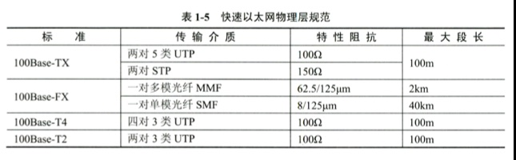

干兆以太网

  
1000Mbps以太网的传输速率更快，作为主干网提供无阻塞的数据传输服务。1996年3月，IEEE成立了802.3z工作组，开始制定100Mbps以太网标准。后来又成立了有100多家公司参加的千兆以太网联盟(GigabitEthernetAlliance,GEA)，支持IEEE802.3z工作组的各项活动。  
1998年6月公布的IEEE802.3z和1999年6月公布的IEEE802.3ab已经成为千兆以太网的正式标准，它们规定了4种传输介质，如表1-6所示。  
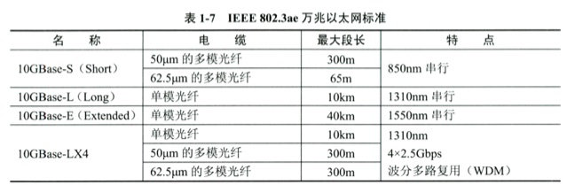  
实现千兆数据速率需要采用新的数据处理技术。首先是最小帧长需要扩展，以便在半双工的情况下增加跨距。另外，802.3z还定义了一种帧突发方式(FrameBursting)，使得一个站可以连续发送多个帧。最后，物理层编码也采用了与10Mbps不同的编码方法，即4B/5B或8B/9B编码法。千兆以太网标准适用于已安装的综合布线基础之上，以保护用户的投资。

万兆以太网

2002年6月，IEEE802.3ae标准发布，支持10Gbps的传输速率，相应的标准如表1-7所示。传统以太网采用CSMA/CD协议，即带冲突检测的载波监听多路访问技术。与千兆以太网一样，万兆以太网基本应用于点到点线路，不再共享带宽，没有冲突检测，载波监昕和多路访问技术也不再重要。千兆以太网和万兆以太网采用与传统以太网同样的帧结构。

tu

## 虚拟局域网

虚拟局域网(Virtual Local Area Network,VLAN)是根据管理功能、组织机构或应用类型对交换局域网进行分段而形成的逻辑网络。虚拟局域网与物理局域网具有同样的属性，然而其中的工作站可以不属于同一个物理网段。任何交换端口都可以分配给某个VLAN，属于同一个VLAN的所有端口构成一个广播域。每一个VLAN都是一个逻辑网络，发往VLAN之外的分组必须通过路由器进行转发。

在交换机上实现VLAN，可以采用静态的或动态的方法。

(1)静态分配VLAN。为交换机的各个端口指定所属的VLAN。这种基于端口的划分方法是把各个端口固定地分配给不同的VLAN，任何连接到交换机的设备都属于接入端口所在的VLAN。

(2)动态分配VLAN。动态VLAN通过网络管理软件包来创建，可以根据设备的MAC地址、网络层协议、网络层地址、IP广播域或管理策略来划分VLAN。根据MAC地址划分VLAN的方法应用最多，一般交换机都支持这种方法。无论一台设备连接到交换网络的什么地方，接入交换机根据设备的MAC地址就可以确定该设备的VLAN成员身份。这种方法使得用户可以在交换网络中改变接入位置，而仍能访问所属的VLAN。但是，当用户数量很多时，对每个用户设备分配VLAN的工作量是很大的管理负担。  
把物理网络划分成VLAN的好处有控制网络流量、提高网络的安全性以及灵活的网络管理。  
IEEE802.lq定义了VLAN帧标记的格式，在原来的以太帧中增加了4个字节的标记(Tag)字段，如图所示。其中，标记控制信息(TagControlInformation,TCI)包含Priority、CFI和VID3个部分。

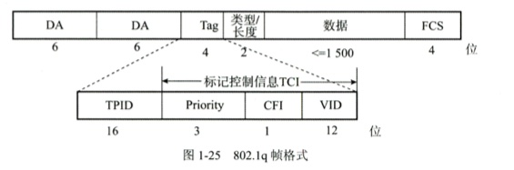

# 冗余网关技术

在进行大、中型网络设计时，网络核心设备的备份是设计者必须要考虑的问题，就如同服务器采用多硬盘RAID提高数据的安全性一样。路由器作为整个网络的核心设备，如果发生致命性的故障，将导致本地网络的瘫痪。

在进行网络规划时，通常将**2个或2个以上的路由器互为热备**，如果有一台路由器出故障不能正常工作，路由将自动切换到其他路由器上，这种机制也称为网络系统中的**心跳机制**。在网络系统中采用心跳机制的协议通常包括  
**VRRP(Virtual Router Redundancy Protocol，虚拟路由冗余协议)、**  
**HSRP(Hot Standby Router Protocol，热备份路由器协议)**  
**GLBP(Gateway Load Balancing Protocol，网关负载均衡协议)**。在网络规划时通常将解决此类问题的技术称为冗余网关技术，VRRP是国际标准协议，多见于国产设备及网络平台，GLBP与HSRP是思科网络的专有协议，通常只应用在其私有平台。

## VRRP

VRRP是由IETF提出的解决局域网中配置静态网关出现单点失效现象的路由协议，1998年推出正式的RFC2338协议标准。

可以将VRRP理解成一种选择协议，它可以把一个虚拟路由器担负的任务动态分配到局域网上的VRRP路由器中的一台。控制虚拟路由器IP地址的VRRP路由器称为主路由器，它负责转发数据包到这些虚拟IP地址。一旦主路由器不可用，这种选择过程就提供了动态的故障转移机制，允许虚拟路由器的IP地址作为终端主机的默认第一跳路由器。这样主机发出的目的地址不在本网段的报文将被通过缺省网关发往三层交换机，从而实现了主机和外部网络的通信。

也可以将VRRP理解成一种路由容错协议，也可以叫作备份路由协议。当缺省路由器down掉(即端口关闭)之后，内部主机将无法与外部通信，如果路由器设置了VRRP，那么这时，虚拟路由将启用备份路由器，从而实现全网通信。在VRRP协议中，有两组重要的概念:VRRP路由器和虚拟路由器，主控路由器和备份路由器。VRRP路由器是指运行VRRP的路由器，是物理实体:虚拟路由器是指VRRP协议创建的，是逻辑概念。一组VRRP路由器协同工作，共同构成一台虚拟路由器。该虚拟路由器对外表现为一个具有唯一固定的IP地址和MAC地址的逻辑路由器。处于同一个VRRP组中的路由器具有两种互斥的角色:主控路由器和备份路由器。一个VRRP组中有且只有一台处于主控角色的路由器，可以有一个或者多个处于备份角色的路由器。VRRP协议从路由器组中选出一台作为主控路由器，负责ARP解析和转发IP数据包，组中的其他路由器作为备份的角色井处于待命状态，当由于某种原因，主控路由器发生故障时，其中的一台备份路由器能在瞬间的时延后升级为主控路由器，由于此切换非常迅速而且不用改变IP地址和MAC地址，故对终端使用者系统是透明的。

## HSRP

热备份路由器协议HSRP)的设计目标是支持特定情况下，IP流量失败转移不会引起混乱，并允许主机使用单路由器，以及即使在实际第一跳路由器使用失败的情形下仍能维护路由器间的连通性。

负责转发数据包的路由器称为主动路由器(Active Router)。一旦主动路由器出现故障，HSRP将激活备份路由器(Standby Routers)取代主动路由器。HSRP协议提供了一种决定使用主动路由器还是备份路由器的机制，并指定一个虚拟的IP地址作为网络系统的缺省网关地址。如果主动路由器出现故障，备份路由器(StandbyRouters)承接主动路由器的所有任务，并且不会导致主机连通中断现象。

HSRP运行在UDP上，采用端口号1985。路由器转发协议数据包的源地址使用的是实际IP地址，而并非虚拟地址，正是基于这一点，HSRP路由间能相互识别。

实现HSRP的条件是系统中有多台路由器，它们组成一个“热备份组”，这个组形成一个虚拟路由器。在任一时刻，一个组内只有一个路由器是活动的，并由它来转发数据包，如果活动路由器发生了故障，将选择一个备份路由器来替代活动路由器，但是在本网络内的主机看来，虚拟路由器没有改变。所以主机仍然保持连接，没有受到故障的影响  
为了减少网络的数据流量，在设置完活动路由器和备份路由器之后，只有活动路由器和备份路由器定时发送HSRP报丈。如果活动路由器失效，备份路由器将接管成为活动路由器。如果备份路由器失效或者变成了活跃路由器，将由另外的路由器被选为备份路由器。  
HSRP协议利用一个优先级方案来决定哪个配置了HSRP协议的路由器成为默认的主动路由器。路由器的缺省优先级是100，所以如果只设置一个路由器的优先级高于100，则该路由器将成为主动路由器。  
通过在设置了HSRP协议的路由器之间广播HSRP优先级，HSRP协议选出当前的主动路由器。当在预先设定的一段时间内主动路由器不能发送hello消息时，优先级最高的备用路由器变为主动路由器。路由器之间的包传输对网络上的所有主机来说都是透明的。

## GLBP

与HSRP、VRRP不同的是，GLBP不仅提供冗余网关，还在各网关之间提供负载均衡，而HSRP、VRRP都必须选定一个活动路由器，而备用路由器则处于闲置状态。和HSRP不同的是，GLBP可以绑定多个MAC地址到虚拟IP，从而允许客户端选择不同的路由器作为其默认网关，而网关地址仍使用相同的虚拟IP，从而实现一定的冗余。

优先级最高的路由器成为活动路由器，称作Acitve Virtual Gateway(AVG)，其他非AVG提供元余。某路由器被推举为AVG后，AVG分配虚拟的MAC地址给其他GLBP组成员。所有的GLBP组中的路由器都转发包，但是各路由器只负责转发与自己的虚拟MAC地址相关的数据包。

通常来说，VRRP、HSRP和GLBP的区别在于是否同时只存在一个物理端口处于ACTIVE状态。VRRP与HSRP的区别在于设备间的认证机制、初始状态、报文数量、安全性等方面略有不同。

## VRRP主备备份配置示例

VRRP的主备备份配置的连接拓扑图如图所示。PCl通过Switch双归属到RouterA和RouterB。主机以RouterA为默认网关接入Internet，当RouterA故障时，RouterB接替作为网关继续进行工作，实现网关的冗余备份，RouterA故障恢复后，可以重新成为网关。

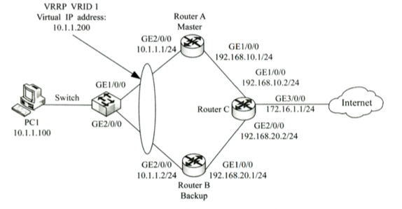  
采用VRRP主备备份实现网关冗余备份包括如下步骤:

配置各设备接口IP地址及路由协议，使各设备间网络层连通。

在RouterA和RouterB上配置VRRP备份组。其中，RouterA上配置较高优先级和20秒抢占延时，作为Master设备承担流量转发:RouterB上配置较低优先级，作为备用路由器，实现网关冗余备份。

1  
2  
3  
4  
5  
6  
7  
8  
9  
10  
11  
12  
13  
14  
15  
16  
17  
18  
19  
20  
21  
22  
23  
24  
25  
26  
27  
28  
29  
30  
31  
32  
33  
34  
35  
36  
37  
38  
39  
40  
41  
42  
43  
44  
45  
46  
47  
48  
49  
50  
51  
52  
53  
54  
55  
56  
57  
58  
59  
60  
61  
62  
63  
64  
65  
66  
67  
68  
69  
70  
71  
72  
73  
74  
75  
76  
77  
78  
79  
80  
81  
82  
83  
84  
85  
86  
87  
88  
89  
90  
91  
92  
93  
94  
95  
96  
97  
98  
99  
100  
101  
102  
103  
104  
105  
106  
107  
108  
109  
110  
111  
112  
113  
114  
115  
116  
117  
118  
119  
120  
121  
122  
123  

(1)配置设备间的网络互连  
  
#配置设备各接口的IP地址，以RouterA为例。RouterB和RouterC的配置与RouterA类似。  
<Huawei>system-view  
\[Huawei\]sysnarne RouterA  
\[RouterA\]interface gigabitethernet 2/0/0  
\[RouterA-GigabitEthernet2/0/0\]ip address 10.1.1.24  
\[RouterA-GigabitEthernet2/0/0\]quit  
\[RouterA\]interface gigabitethernet 1/0/0  
\[RouterA-GigabitEthernetl/0/0\]ip address 192.168.10.124  
\[RouterA-GigabitEthernetl/0/0\]quit  
  
#配置RouterA、RouterB和RouterC间采用OSPF协议进行互连。以RouterA为例，RouterB和RouterC的配置与RouterA类似。  
\[RouterA\]ospf 1  
\[RouterA-ospf-1\]area 0  
\[RouterA-ospf-1-area-0.0.0.0\]network 10.1.1.0 0.0.0.255  
\[RouterA-ospf-1-area-0.0.0.0\]network 192.168.10.0 0.0.0.255  
\[RouterA-ospf-1-area-0.0.0.0\]quit  
\[RouterA-ospf-1\]quit  
(2)配置VRRP备份组。  
#在RouterA上创建VRRP备份组1，配置RouterA在该备份组中优先级为120，并配置抢占时间为20s  
  
\[RouterA\]interface gigabitethemet2/0/0  
\[RouterA-GigabitEthemet2/0/0\]vrrp vrid 1 virtual-ip 10.1.1.200  
\[RouterA-GigabitEthemet2/0/0\]vrrp vrid 1 priority 120  
\[RouterA-GigabitEthernet2/0/0\]vrrp vrid 1 preempt-mode timer delay 20  
\[RouterA-GigabitEthemet2/0/0\]quit  
  
#在RouterB上创建VRRP备份组1，其在该备份组中的优先级为缺省值100。  
  
\[RouterB\]interface gigabitethernet 2/0/0  
\[RouterB-GigabitEthernet2/0/0\]vrrp vrid 1 virtual-ip 10.1.1.200  
\[RouterB-GigabitEthernet2/0/0\]quit  
  
(3)测试配置结果。  
  
#完成上述配置以后，在RouterA和RouterB上分别执行display vrrp命令，可以看到RouterA在备份组中的状态为Master,RouterB在备份组中的状态为Backup。  
\[RouterA\]display vrrp  
GigabitEthemet2/0/0 |Virtual Router 1  
State:Master  
VirtualIP:10.1.1.200  
MasterIP:10.1.1  
PriorityRun:120  
PriorityConfig:120  
MasterPriority:120  
Preempt:YES DelayTime:20s  
TimerRun·1s  
TimerConfig:1s  
Authtype:NONE  
VirtualMAC:0000-5e00-0101  
CheckTTL:YES  
Configtype.normal-vrrp  
Backup-forward:disabled  
Createtime:2012-05-11 11:39:18  
Lastchangetime:2021-05-26 11:38:58  
\[RouterB\]display vrrp  
GigabitEthemet2/0/0|VirtualRouter1  
State:Backup  
Virtual IP:10.1.1.200  
Master IP:10.1.1.1  
PriorityRun:100  
PriorityConfig:100  
MasterPriority:120  
Preempt:YES DelayTime:0s   
Timer Run.1s  
Timer Config:1s  
Auth type:NONE  
Virtual MAC:0000-5e00-0101  
Check TTL:YES  
Configtype:normal-vrrpBackup-forward:disabled  
Createtime:2021-05-1111:39:18  
Lastchangetime:2021-05-2611:38:58  
  
#在RouterA的接口GE2/0/0上执行shutdown命令,模拟RouterA出现故障  
\[RouterA\]interface gigabitethemet2/0/0  
\[RouterA-GigabitEthemet2/0/0\]shutdown  
\[RouterA-GigabitEthemet2/0/0\]quit  
  
#在RouterB上执行display vrrp命令查看VRRP状态信息，可以看到RouterB的状态是Master  
\[RouterB\]display vrrp  
  
GigabitEthemet2/0/0|VirtualRouter1  
  
State:Master  
Virtual IP:10.1.1.200  
Master IP:10.1.1.2  
PriorityRun:100  
PriorityConfig:100  
MasterPriority:100  
Preempt:YES DelayTime:0s  
TimerRun:1s  
TimerConfig:1s  
Authtype:NONE  
Virtual MAC:0000-5e00-0101  
Check TTL:YES  
Config type:normal-vrrp  
Backup-forward:disabled  
Create time:2021-05-11 11:39:18  
Last change time:2021-05-26 11:38:58  
  
#在RouterA的接口GE2/0/0上执行undo shutdown命令，等待20秒后，在RouterA上执行display vrrp命令查看VRRP状态信息，可以看到RouterA的状态恢复成Master。  
  
\[RouterA\]interface gigabitethemet 2/0/0  
\[RouterA-GigabitEthemet2/0/0\]undo shutdown  
\[RouterA-GigabitEthemet2/0/0\]quit  
\[RouterA\]display vrrp  
GigabitEthemet2/0/0|VirtualRouter1  
State:Master  
VirtualIP:10.1.1.200  
MasterIP:10.1.1.1  
PriorityRun:120  
PriorityConfig:120  
MasterPriority:120  
Preempt:YESDelayTime:20s  
TimerRun:1s  
TimerConfig:1s  
Auth type:NONE  
Virtual MAC:OOOO-5e00-0101  
Check TTL:YES  
Config type:normal-vrrp  
Backup-forward:disabled  
Create time:2021-05-11 11:39:18  
Last change time:2021-05-26 11:38:58  

# 以太环网保护技术

以太环网技术日趋成熟且成本低廉，在城域网和企业网采用以太环网已经成为一种趋势。但以太网协议采用的报文分发复制机制在解决设备“相互认识 ”的同时也容易 引发“广播风暴 ”，因此在以太环网的构建时就必须考虑采用什么样的保护技术来避免此类故障的产生。

通常情况下， 解决二层网络环路问题的技术是 STP， 因其收敛的时间比较长(秒级) ， 并不适用于主干线路的保护。 2004年 6月， IEEE802.17标准规范了弹性分组环(Resilient Packet Ring, RPR) 的介质访问控制方法、物理层接口以及层管理参数， 并提出了用于环路检测和配置、 失效恢复以及带宽管理的一系列协议。 IEEE802.17标准也定义了环网与各种物理层的接口和系统管理信息库。 RPR支持的数据速率可达10Gbps。 RPR针对承载IP业务进行了优化， 是 一种相对典型的以太环网的保护技术 。

## 弹性分组环

RPR 的体系结构如图所示。 MAC 服务接口提供上层协议的服务原语: MAC 控制子  
层控制 MAC 数据通路， 维护 MAC 状态， 并协调各种 MAC 功能的相互作用; MAC 数据通路子层提供数据传输功能: MAC子层通过PHY服务接口发送/接收分组。  
  
RPC采用了双环结构，由内层的环 1 (Ringlet 1)和外层的环 0 (Ringlet0)组成，每个环都是单方向传送，如图所示。相邻工作站之间的跨距( Span)包含传送方向相反的两条链路(Link) 。如果X站接收Y站发出的分组，则X是Y的下游站，而Y是X的上游站。 RPR 支持多达 255 个工作站，最大环周长为2000km。  

RPR 中包括如下关键技术。  
帧结构  
RPR 位于数据链路层( Data Link)，包括逻辑链路控制子层( LLC)、 MAC 控制子层 、MAC 数据通路子层。 LLC 与 MAC 控制子层之间是 MAC 服务接口 。 MAC 服务接口支持把来自 LLC 的数据传送到一个或多个远端同样的逻辑链路控制子层。 MAC 控制子层执行与特定小环无关的数据寻路行为和维护 MAC 状态所需要的控制行为 。 MAC 控制子层与 MAC 数据通道子层之间发送或接收RPRMAC帧。MAC 数据通路子层则与某个特定的小环之间执行访问控制 和数据传送。物理层服务接口用于 MAC 数据通路子层向物理媒介发送或从物理媒介接收RPRMAC 帧 。

RPRMAC对数据帧的处理方式  
RPRMAC对数据帧的处理方式有上环、下环、过环以及剥离4种。

上环是指本点用户端口向环上其他站点发送信息时需要进行上环操作，通过拓扑发现和路由表项决定其目的站点地址以及环选择 ， 根据对应的优先级送入相应的队列，最后产生 RPR 帧头后插入到各环端口 。

下环是指本点从环上接收其他站点发送过来的到本点的单播帧或多播帧，经过 StackVLAN过滤后接收。对于单播帧，将其从环上剥离井发送到用户端口:对于多擂帧，将其发送到用户端口的同时进行过环操作 。

过环是指本点从环上接收的帧根据其优先级(A、 B、 C)分别放入 PTQ 和 STQ 转发通道，发送时将 PTQ 和 STQ 队列中的数据帧直接插入源环发送端口 。

剥离是指本点从环上接收的帧不再继续向下传递 ，到本点终结 。

## 公平算法原理

RPR 技术所采用的公平算法是一种保证环上所有站点之间公平性的机制，通过这种算法可以达到带宽的动态调整和共享的目的。 RPR 公平算法的主要作用有两个: 一是应用于从 MAC 客户来的低优先级服务和超额中优先级服务(即中优先级服务中 EIR 数据帧)的业务，对于B类CIR以及A类业务不进行控制 : 二是分别控制两个子环的公平带宽，即每个RPRMAC有两个互相独立的公平协议分别调整上环的带宽 。  
RPR公平算法是通过对阻塞的检测来触发带宽调整而实现的 。当环上某一个节点发生阻塞时，它就会在相反的环上向上行节点发布一个公平速率， 当上行站点收到这个公平速率时，就调整自己的发送速率以不超过公平速率。接收到这个公平速率的站点会根据不同情况做出两种反应: 若当前节点阻塞，它就在自己的公平速率(通过本点的add\_rate和归一化的权重得到) 和收到的公平速率之间选择最小值公布给上行节点 : 若当前节点不阻塞，节点就将公平速率向上游继续传递 。

## 拓扑发现原理

通过 RPR 的拓扑发现原理，可以使每个站点都能了解环的完整结构、各点距离自身的跳数以及环上各个站点所具备的能力等 ，从而为环选择 、 公平算法、保护等单元提供决策依据 。 RPR拓扑发现是一种周期性的活动，但是也可以由某一个需要知道拓扑的节点发起，也就是说，某个节点可以在必要的时候产生一个拓扑信息帧(如此节点刚刚进入RPR环中，接收到一个保护切换需求信息或者节点监测到了光纤链路差错)。  
RPR的拓扑信息产生周期可以任意配置， 一般为50ms~10s，以50ms为最小分辨率， 默认值为 100ms。

## 保护原理

RPRMAC 层保护可支持 Steering 保护或 Wrapping 保护，用户可以指配是否同时采用 RPRMAC 层的保护和 SDH 物理层的保护。当同时采用 RPRMAC 层保护和 SDH 保护时 ，可以采用拖延RPR层倒换时间来支持层间倒换，以保证两种倒换不会重叠发生。

RPR 的保护时间有拖延时间和等待恢复时间两种 。 拖延时间为检测到业务失效到启动倒换之间的等待时间(时间范围为 0~10s，步进级别为100ms) ， 在这段时间内如果业务恢复， 将不发生倒换;等待恢复时间为从故障恢复到业务故障状态清除(取消保护状态)之间的等待时间 (时间范围为 0~1440s，步进级别为秒级可设置，默认为 10s)，在这段时间内如果业务失效 ，业务故障状态将不再清除 。

# 以太网环保护交换

在 2008 年 12 月举行的 ITU-TSG15 会议上，对以太环网保护标准 G.8032 的 V1 版本进行修订 ，增加以太网环保护交换 (Ethernet Ring Protection Switching, ERPS)方案，形成 ITU-TG.8032 ERPS 以太环网标准 ， 该标准吸取了 EAPS、 RPR、 SDH、 STP 等众多环网保护技术的优点，优化了检测机制，可以检测双向故障，支持多环、多域的结构， 在实现 50ms 倒换的同时，支持主备，负荷分担多种工作方式，成为二层网络中重要的冗余保护手段 。

下面按照链路正常→链路故障→链路恢复的过程(包括保护倒换操作) ， 介绍基本的单环 组网下 E盯 S 的实现原理。

链路正常  
如图所示，由 SwitchA~ SwitchE组成的环路上各设备通信正常。为防止环路产生，ERPS 首先会阻塞 RPL owner端口，如果配置了 RPL neighbour端口，该端口同样会被阻塞，其他端口可以正常转发业务流量。

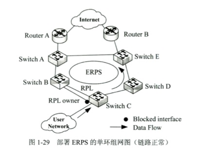

ERPS环上的RPL owner端口 以5s的时间间隔为周期向环中其他节点发送 NRRB RAPS报文，表示ERPS环当前链路一切正常。

链路故障

如图所示 ， 当 Switch D 和 Switch E 之间的链路发生故障时， ERPS 协议启动保护倒换机制， 将故障链路的两端端口阻塞 ， 然后放开 RPL owner 端口和 RPL neighbour 端口 ， 这两 个端口重新恢复用户流量的接收和发送，从而保证了流量不中断。 具体处理过程如下:

SwitchD和 SwitchE检测到链路故障，将故障链路上的端口阻塞，并刷新本设备的FDB表项。  
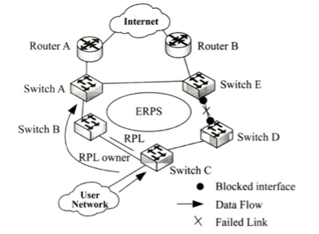  
然后，SwitchD和 SwitchE向外发送携带本地端口链路故障消息的SF RAPS报文，即一旦感知到链路故障， Switch D 和 Switch E 会连续发送 3 个相同的 RAPS 报文 ，然后 以 5s 的间隔持续稳定发送 。  
其他设备收到 SwitchD和 SwitchE发送的 SFRAPS报文后，都刷新本设备的 FDB表项。 当 Switch C 设备( RPLowner 端口所在设备)收到该 RAPS 报文后，放开 RPL owner 端口 ， 并刷新自己的FDB表项。 同样， 当 SwitchB设备(RPL neighbour端口所在设备)收到 RAPS报文后，放开 RPL neighbour端口，井刷新自己的 FDB 表项。

链路恢复

链路恢复正常后 ， 如果 ERPS 环配置的是回切模式， RPL owner 端口所在设备会重新阻塞 RPL链路上的流量， 故障链路重新被用来完成用户流量的传送。 如果 ERPS环配置的是非回切模式，阻塞链路还保持在原来的故障链路上，不会重新切回到 RPL上。 以回切模式为例， 具体恢复过程如下:

当 SwitchD和 SwitchE之间的链路恢复后 ，SwitchD和 SwitchE为了防止收到过期的 RAPS 协议报文， 分别启动 Guard Timer定时器， 在该定时器超时前不接收其他 RAPS 协议报文。 同时 Switch D 和 Switch E 会向外发送 NRRAPS 报文 。

当 RPLowner 端口所在设备( Switch C) 收到 NR RAPS 报文后，启动 WTR Timer 定时器 。 当该定时器超时后， RPLowner端口被阻塞， 同时向外发送 NRRB RAPS 报文。

当 Switch D 和 Switch E 收到 Switch C 发送的 NRRB RAPS 协议报文后 ， 将自己设备上原来阻塞的端口放开， 停止发送 NR RAPS 协议报文并且完成 FDB 表项的刷新。 其他设备收到 SwitchC发送的NRRBRAPS协议报文后， 也完成FDB表项的刷新。

保护倒换  
强制切换  
如图所示 ， 当由 Switch A~ Switch E 组成的环路上各设备通信正常时 ， 在 Switch E设备与SwitchD相连的端口上执行强制切换将端口阻塞， RPLowner端口和RPLneighbour端口同样会被放开 ， 这两个端口重新恢复用户流量的接收和发送 ， 从而保证了流量不中断 。 具体 处理过程如下:  
Switch E 与 Switch D 相连的端口被强制阻塞后 ，刷新本设备的 FDB 表项 。  
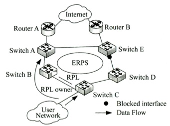

# 城域网

城域网比局域网的传输距离远，能够覆盖整个城市范围，城域网有更大的传输容量， 更高的传输效率，还要有多种接入手段，以满足不同用户的需要。城域网作为开放型的综合平台， 要求能够提供分组传输的数据 、语音 、图像和视频等多媒体综合业务 。

城域以太网论坛(Metro Ethernet Forum, MEF)是由网络设备制造商和网络运营商组成的非营利性组织 ， 专门从事城域以太网的标准化工作 。 MEF 的承载以太网( Carrier Ethernet) 技术规范提出了以下几种业务类型 。

以太网专用线( Ethernet Private Line, EPL) 。 在一对用户以太网之间建立固定速率的点对点专线连接。

以太网虚拟专线( Ethernet Virtual Private Line, EVPL)。在一对用户以太网之间通过第三层技术提供点对点的虚拟以太网连接，支持承诺的信息速率(CIR) 、峰值信息速率 (PIR) 和突发式通信。

以太局域网服务(E-LAN Services)。由运营商建立一个城域以太网，在用户以太网之间提供多点对多 的第二层连接 ，任意两个用户以太网之间都可以通过城域以太网通信。  
其中的第 3 种技术被认为是最有前途的解决方案。提供 E-LAN 服务的基本技术是802.lq的 VLAN帧标记。假定各个用户的以太网称为C-网，运营商建立的城域以太网称为 S-网 。 如果不同 C-网中的用户要进行通信，以太帧在进入用户网络接口( User-Network Interface, UNI)时被插入一个 S-VID ( Server Provider-VLAN ID)字段 ， 用于标识S-网中的传输服务， 而用户的VLAN帧标记(C-VID) 则保持不变， 当以太帧到达目标C-网时， S-VID 字段被删除 ，如图所示，这样就解决了两个用户以太网之间透明的数据传输问题。这种技术定义在 IEEE 802.lad 的运营商网桥协议( Provider Bridge Protocol)中 ， 被称为 Q-in-Q 技术。

Q-in-Q 实际上是把用户 VLAN 嵌套在城域以太网的 VLAN 中传送 ， 由于其简单性和有效性而得到电信运营商的青睐。但是这样一来，所有用户的 MAC 地址在城域以太网中都是可见的， 任何 C-网的改变都会影响到 S-网的配置，增加了管理的难度。而且 S-VID字段只有 12位， 只能标识 4096 个不同的传输服务，网络的可扩展性也受到限制 。 从用户角度看，网络用户的 MAC 地址都暴露在整个城域以太网中，使得网络的安全性受到威胁 。

为了解决上述问题， IEEE802.lah标准提出了运营商主干网桥(Provider Backbone Bridge, PBB)协议。所谓主干网桥，就是运营商网络边界的网桥 ，通过 PBB 对用户以太帧再封装一层运营商的 MAC 帧头，添加主干网目标地址和源地址（B-DA,B-SA)、主干网 VLAN标识(B-VID)以及服务标识 （I-SID）等字段，如图所示，由于用户以太帧被封装在主干网以太帧中，所以这种技术被称为 MAC-in-MAC 技术 。  
按照 802.lah协议， 主干网与用户网具有不同的地址空间。主干网的核心交换机只处理通常的以太网帧头，仅主干网边界交换机才具有 PBB 功能 。 这样，用户网和 主干网被 PBB 隔离，使得扁平式的以太网变成了层次化结构，简化了网络管理， 保证了网络安全。 802.lah协议规定的服务标识（I-SID)字段为 24 位 ， 可以区分 1600 万种不同的服务 ， 使得网络的扩展性得以提升 。 由于采用了 二层技术 ， 没有复杂的信令机制，因此设备成本和维护成本较低，被认为是城域以太网的最终解决方案。目前，IEEE802.lah标准正在完善之中。
