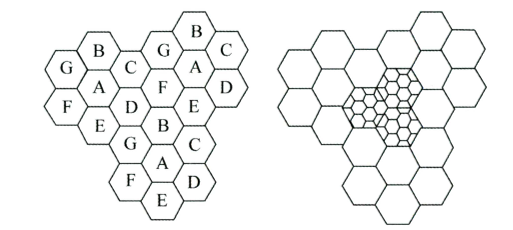
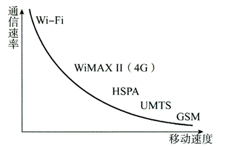
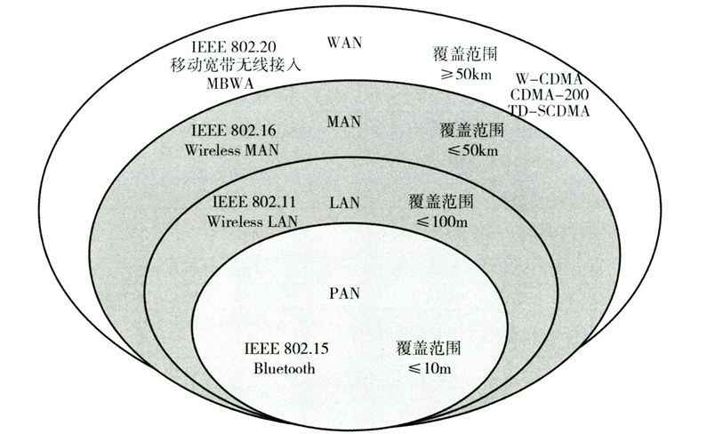

1978年，美国贝尔实验室开发了高级移动电话系统(Advanced Mobile Phone System, AMPS)，这是第一个具有随时随地通信能力的大容量移动通信系统 。 AMPS 采用模拟制式的频分双工(Frequency Division Duplex, FDD)技术，用一对频率分别提供上行和下行信道 。AMPS 采用蜂窝技术解决了公用移动通信系统所面临的大容量要求与频谱资源限制的矛盾 。 到了 1980 年中期，欧洲和日本都建立了第一代蜂窝移动电话系统。

蜂窝网络把一个地理区域划分成若干个称为蜂窝的小区 (Cell) 。 在模拟移动电话系统中，一个话音连接要占用一个单独的频率。如果把通信网络覆盖的地区划分成一个一个的小区 ，则在不同小区之间就可以实现频率复用。在图中，一个基站覆盖的小区用一个字母来代表，在一个小区内可以用一组频率提供一组用户进行通话。 相邻小区不能使用相同的通信频率，同一字母(例如 A)代表的小区可以使用同样的通信频率，使用同样频率的小区之间有两个频率不同的小区作为分隔。如果要增加通信频率的复用程度，可以把小区划分得更小 。  
图  
当用户移动到一个小区的边沿时，电话信号的衰减程度提醒相邻的基站进行切换(handoff) 操作， 正在通话的用户就自动切换到另一个小区的频段继续通话。切换过程是通过移动电话交换局( MTSO)在相邻的两个基站之间进行的 ，不需要电话用户的干预

## 第二代移动通信系统

第 二代移动通信系统是数字蜂窝电话，在世界不同的地方采用了不同的数字调制方式。我国最初采用欧洲电信的GSM (Global System for Mobile)系统和美国高通公司的码分多址 (CDMA )系统。

### 全球移动通信系统 GSM

GSM 系统工作在 900MHz~ 1 800MHz 频段，无线接口采用 TDMA 技术，提供话音和数据 业务。图所示为工作在900MHz频段的GSM系统的频带利用情况。  
  
图中的每一行表示一个带宽为 200kHz的单工信道，GSM系统有 124对这样的单工信道(上行链路 890MHz~915MHz，下行链路 935MHz~960MHz)，每一个信道采用时分多 路 CTDMA)方式可支持 8 个用户会话，在一个蜂窝小区中同时通话的用户数为 124×8=992。 为同一用户指定的上行链路与下行链路之间相差3个时槽，如图中的阴影部分所示，这是因为终端设备不能同时发送和接收，需要留出一定时间在上下行信道之间进行切换 。

### 码分多址技术

美国高通公司的第二代数字蜂窝移动通信系统工作在 800MHz 频段，采用码分多址 (CDMA)技术提供话音和数据业务，因其频率利用率高 ，所以 同样的频率可以提供更多的话音信道，而且通话质量和保密性也较好。

码分多址 (Code Division Multiple Access, CDMA)是一种扩频多址数字通信技术，通过独特的代码序列建立信道。在CDMA系统中，对不同的用户分配了不同的码片序列，使得彼此不会造成干扰。 用户得到的码片序列由+ 1和-1组成，每个序列与本身进行点积得到+ 1，与补码进行点积得到-1， 一个码片序列与不同的码片序列进行点积将得到 0 (正交性)。例如，对用户 A 分配的码片系列为 $C_{A1}$ (表示 “1”)， 其补码为 $C_{A0}$(表示“0” ) :

$C_{A1}$= (-1，-1，-1，-1) $C_{A0}$= (+1，+1，+1，+1)

对用户B分配的码片序列为$C_{B1}$(表示“1”)， 其补码为$C_{B0}$(表示“0”):

$C_{B1}$= (+1，-1，+1，-1) $C_{B0}$= (-1，+1，-1，+1)

则计算点积如下:

$C_{A1}•C_{A1} =(-1 ，-1，-1 ，-1)•(-1，-1，-1，-1) /4 = + 1\\$ $C_{A1}•C_{A0} = (-1 ，-1，-1，-1)•( +1，+1，+1，+1) /4 =-1\\$ $C_{A1}•C_{B1}=(-1，-1，-1，-1)•(+1，-1，+1，-1)/4=0\\$ $C_{A1}•C_{B0}= ( -1 ，-1 ，-1，-1 )•( -1，+1，-1，+1) / 4 = 0\\$

在码分多址通信系统中 ， 不同用户传输的信号不是用频率或时隙来区分 ，而是使用不同的

码片序列来区分。 如果从频域或时域来观察，多个 CDMA 信号是互相重叠的。接收机用相关器可以在多个 CDMA 信号中选出预定的码型信号，其他不同码型的信号因为和接收机产生的码型不同而不能被解调，它们的存在类似于信道中存在的噪声和干扰信号，通常称之为多址干扰。  
在 CDMA 蜂窝通信系统中，用户之间的信息传输是由基站进行控制和转发的 。 为了实现双工通信，正向传输和反向传输各使用一个频率，即所谓的频分双工(FDD)技术。 无论正向传输或反向传输，除去传输业务信息外，还必须传输相应的控制信息。为了传送不同的信息，需要设置不同的信道。但是，CDMA 通信系统既不分频道又不分时隙，无论传输何种信息的信道 都采用不同的码型来区分 。

## 第二代移动通信升级版 2.5G

2.5G 是 比 2G 速度快 ，但又慢于 3G 的通信技术规范。 2.5G 系统能够提供 3G 系统中才 有的一些功能，例如分组交换业务， 也能共享2G时代开发出来的TDMA或CDMA网络。 常 见的 2.5G 系统是通用分组无线业务 GPRS CGeneral Packet Radio Service)。 GPRS 分组网络 重叠在 GSM 网络之上，利用 GSM 网络中未使用的 TDMA 信道为用户提供中等速度的移动数据业务 。  
GPRS 基于分组交换的技术，也就是说多个用户可以共享带宽，适合于像 Web 浏览、 Email 收发和即时消息那样的共享带宽的间歇性数据传输业务。通常， GPRS 系统是按交换的字节数 计费，而不是按连接时间计费的。 GPRS 系统支持 IP 协议和 PPP 协议 。 理论上的分组交换速度 大约是 170kbps，而实际速度只有 30kbps~70kbps。

对 GPRS 的射频部分进行改进的技术方案称为增强数据速率的 GSM 演进 CEnhanced Data Rates for GSM Evolution, EDGE)。 EDGE 又称为增强型 GPRS CEGPRS)，可以工作在己经部署 GPRS 的网络上，只需要对手机和基站设备做一些简单的升级即可。EDGE被认为是 2.75G 技术， 采用 8PSK 的调制方式代替了 GSM 使用的高斯最小移位键控( GMSK)调制方式，使得 一个码元可以表示3位信息。 从理论上说， EDGE提供的数据速率是GSM系统的3倍。 2003 年， EDGE 被引入北美的 GSM 网络，支持 20kbps~200kbps 的高速数据传输 。

## 第三代移动通信系统

1985年， ITU提出了对第二代移动通信标准的需求， 1996年正式命名为 IM下2000(Intema- tional Mobile Telecommunications-2000)，其中的2000有3层含义:  
使用的频段在 2000MHz 附近。  
通信速率大约为 2000kbps C即 2Mbps)  
预期在 2000 年推广商用 。

1999年ITU批准了5个IMT-2000的无线电接口， 这5个标准如下:  
IMT-DS (Direct Spread) :即 W-CDMA， 属于频分双工模式，在日本和欧洲制定的 UMTS 系统中使用 。  
IMT-MC (Multi-Carrier) : 即CDMA-2000， 属于频分双工模式， 是第二代CDMA系统的继承者 。  
IMT-TC (Time-Code) : 这一标准是中国提出的 TD-SCDMA，属于时分双工模式。  
IMT-SC (Single Carrier) :也称为 EDGE， 是一种 2.75G 技术 。  
IMT-FT (Frequency Time) :也称为 DECT  
2007年 10月 19日，ITU会议批准移动WiMAX作为第6个3G标准，称为IMT-20000 FDMA TDD WMAN， 即无线城域网技术。  
第三代数字蜂窝通信系统提供第二代蜂窝通信系统提供的所有业务类型，并支持移动多媒体业务。在高速车辆行驶时支持 144kbps 的数据速率，在步行和慢速移动环境下支持 384kbps 的数据速率， 在室内静止环境下支持 2Mbps 的高速数据传输， 并保证可靠的服务质量。  
在 3G 网络广泛部署的同时，第四代(4G)移动通信系统也在加紧研发。高速分组接入(High Speed Packet Access,HSPA)是W-CDMA第一个向4G进化的技术， 继HSPA之后的高速上行 分组接入(HighSpeedUplinkPacketAccess, HSUPA)是一种被称为3.75G的技术， 在5MHz 的载波上数据速率可达10Mbps~15Mbps，如采用MIMO技术， 还可以达到28Mbps。  
4G的传输速率应该达到400Mbps， 可以把蓝牙个域网、 无线局域网(Wi-Fi)和 3G技术 等结合在一起， 组成无缝的通信解决方案。 不同的无线通信系统对数据传输速度和移动性的支持各不相同，如图所示。

## 4GLTE 技术

### 802.16e

802.16d 的 OFDM 调制方式采用 256 个子载波，OFDMA 调制方式采用 2048 个子载波，信 号带宽在 1.25MHz~20MHz 可变。为了支持移动性， 802.16e对物理层进行了改进 ，使得 OFDMA可支持 128、512, 1024和 2048共4种不同的子载波数量， 但子载波间隔不变， 信号带宽与子载波数量成正比，这种技术被称为可扩展的 OFDMA (Scalable OFDMA) 。 采用这种技术，系统可以在移动环境中灵活地适应信道带宽的变化。在采用 20 MHz 带宽、 64-QAM 调制的情况下， 传输速率可达到 74.81Mbps。  
802.16e 对 MAC 层的改进改变了各个功能层之间的消息传输机制，并实现了快速自动请求重传( ARQ )和资源预约功能 ，以 降低信道时延的影响 。 另外还增加了针对上行链路的功率 、 频率和时隙的快速调整功能，以适应快速移动的要求 。  
现在的 IEEE 802.16标准是一种无线城域网技术，与其他的无线接入技术的应用领域和服 务范围不同。各种无线接入技术互相配合，共同提供了从个域网到广域网的各种无线宽带接入 服务，如图所示。  
图  

### WiMAXII

WiMAX 的进一步发展是与其他 B3G (Beyond 3G)技术融合 ，成为!MT-Advanced 家族的 成员之一。 ITU-R对 4G标准的要求是能够提供基于 IP 的高速声音、 数据和流式多媒体服务， 支持的数据速率至少是100Mbps，选定的通信技术是正交频分多址接入技术 OFDMA。

最初候选的4G标准有 3个，即UMB(Ultra Mobile Broadband)、LTE(Long Term Evolution) 和 WiMAXII (IEEE802.16m) 。  
超级移动宽带 UMB 是由以高通公司为首的 3GPP2 组织推出的 CDMA-2000 的升级版 EV-DOREV.C。 UMB 的最高下载速率可达到 288Mbps，最高上传速率可达到 75Mbps，支持的终端移动速率超过 300km/h。

长期演进 LTE 是沿着 GSM-W-CDMA-HSPA-4G 路线发展的技术，是由以欧洲电信为首的3GPP组织启动的新技术研发项目。和UMB一样， LTE也采用了OFDM/OFDMA作为物理层的核心技术。  
2006年12月批准的 802.16m是向 IMT-Advanced迈进的研究项目。为了达到4G的技术要求， IEEE802.16m的下行峰值速率在低速移动、热点覆盖条件下可以达到1Gbps， 在高速移动、 广域覆盖条件下可以达到100Mbpso 为了向前兼容， 802.16m 准备对 802.16e 采用的 OFDMA 调制方式进行增补 ，进一步提高系统吞吐量和传输速率。  
2008年11月，高通公司宣布放弃UMB技术。 鉴于IEEE802.16e己跻身于3G标准行列， 所以在向 4G 迈进时代就形成了 LIE-Advanced 与 IEEE 802.16m 竞争的格局 ，它们采用的关键技术有许多共同之处， 如表所示。  
表  

2013 年年底，工信部正式向三大运营商发放了 4G 牌照，中国移动、中国电信和中国联通均获得 TD-LTE 牌照，中国移动获得了 130MHz 的频谱资源， 远高于中国电信和中国联通的 40MHz， 各家运营商得到的商用频段划分如下 :

(1)中国移动 : 1880MHz~ 1900MHz、 23201MHz~ 2370MHz、 2575MHz~ 2635MHz。  
(2)中国联通: 2300MHz~ 2320MHz、 2555MHz~ 2575MHz。  
(3)中国电信: 2370MHz~2390MHz、2635MHz~2655MHz。  
其实，对于 LTE 上、下行信道的划分可以使用时分多路(TDD)技术,也可以使用频分多路(FDD)技术，欧洲运营商大多倾向于 FDD-LTE。中国移动受限于 3G 时代的TD-SCDMA网络， 最初就明确要建设 TD-LTE 网络 ， 并在全国许多城市大规模建设 TD-LTE 试验网，而中国联通和中国电信则倾向于建设 FDD-LTE 网络 。  
5G 是具有高速率，低时延和大连接特点的新一代宽带移动通信技术，是实现人机物互联的网络基础设施。作为新 一代移动通信技术，其网络架构、无线技术、应用场景都有了巨大的改变，有大量技术被整合在其中。与4G相比，5G可以提供小于1ms的端到端时延以及99.9999% 的可靠性，极大地丰富了网络应用场景 。 5G 的关键技术包括 : 超密集异构无线网络、大规模多输入多输出、毫米波通信 、 软件定义网络和网络功能虚拟化等 。

## 超密集异构无线网络

异构网络(Heterogeneous Network, HetNet) 是面向未来的创新移动宽带网络架构，由不同大小、类型的小区构成，包括宏小区(Macrocell)、微小区(Microcell)、微微小区(Picocell)、 毫微微小区( Femtocell) 。在宏蜂窝覆盖范围内部署低功率节点 ，通过“多样化的设备形态、 差异化的覆盖方案 、 多频段组网方式” 等实现分层立体网络。在 5G 时代，移动通信网络将是一种基于宏基站、微站与室分的分层实现信号覆盖的集 Wi-Fi (无线连接)、 5G、 LTE (长期演进)等多种网络制式于一身的多元化超密集异构网络 。

## 大规模多输入多输出

大规模多输入多输出(MassiveMIMO)基础的 MIMO技术已经应用在 4G中。2010年，贝尔实验室提出了大规模的MIMO， 研究极端情况下的多用户多输入输出技术，每个基站在多小区的情况下放置无限数量的天线。大规模 MIMO 技术可以由一些并不昂贵的低功耗的天线组件来实现，为实现在高频段上进行移动通信提供了广阔的前景，它可以成倍提升无线频谱效率， 增强网络覆盖和系统容量，帮助运营商最大限度利用已有站址和频谱资源。

## 毫米波通信

毫米波是指由 3GPP(第三代合作伙伴计划)频率规划的 FR2频段(24.25GHz~52.6GHz)。 根据香农公式:$C=B×log_2(1+\frac S N)$， 其中B表示通信带宽， S剧表示信噪比，C表示信道信息传送速率的上限，也就是信道容量。 从公式可以直观地看到信道容量与通信带宽成正比,毫米波频段能提供更大的带宽，而挖掘更大的传输带宽对提升无线通信容量至关重要，超高的通信带宽可助力 5G 通信实现 10 Gbit/s 的高速宽带通信。毫米波在 5G 的多种无线接入技术叠加型移动通信网络中具备两个优势:基于毫米波小基站可以增强高速环境下移动通信的使用体验 : 基于毫米波的移动通信回程极大地提高叠加型网络的组网的灵活性。

## 软件定义网络

软件定义网络 (Software Defined Network, SDN) 是互联网发展的一种新技术。 5G 不仅仅是无线网络的变化，移动网络的其他部分也会发生巨大的本质变化。传统互联网将控制平面与数据平面集合在一起，在设备内部设有封闭式的接口，使得网络封闭、开放扩展性差。 SDN 的引入改变了传统网络的这些缺陷 ， 驱动 CT (通信技术)/ IT (互联网技术)业务深度融合。 SDN 控制下的网络，将变得更加简单，网络的灵活性、可管理性和可扩展性大幅提升 ，并且可以使系统内设备达到简化的效果，便于统一管理、快速部署与维护，是网络低成本建设、 高效率运营的主要策略。

## 网络功能虚拟化

移动数据业务不断涌现，物联网业务大规模、爆发式增长， 对网络的智能化和灵活化提出 了更高的标准。 随着云计算的深入发展和网元功能的逐步简化、 硬件通用化， 网络功能虚拟化 (Network Functions Virtualization, NFV)应运而生 ， 它可 以快速完成系统功能的迭代及新业务 的上线。设备云化后， 软件和硬件彻底解耦， 各式各样的通信设备可以工作在统一的硬件平台 上借助软件形成网络功能 ， 大幅降低网络的建设投资和维护成本。正是基于这些灵活的技术 ， 使得 5G 的多场景应用成为了现实 。

## 网络管理

### 网络管理功能域

网络管理有 5 大功能域，即故障管理( Fault Management)、配置管理( Configuration Management)、计费管理( Accounting Management) 、 性能管理( Performance Management) 和安全管理(Security Management) ， 简写为 FCAPS。传统上，性能、故障和计费管理属于网络监视功能，另外两种属于网络控制功能。

性能管理可选择的性能指标很多，对网络管理有用的两类性能指标是面向服务的性能指标和面向效率的性能指标。面向服务的性能指标应具有较高的优先级。可用性、响应时间、正确性是面向服务的性能指标，吞吐率和利用率是面向效率的性能指标。

故障监视就是要尽快地发现故障，找出故障原因，以便及时采取补救措施。故障管理可分为以下 3 个功能模块:  
1故障检测和报警功能。故障监视代理要随时记录系统出错的情况和可 能引起故障的事件，并把这些信息存储在运行日志数据库中。  
2故障预测功能。对各种可以引起故障的参数建立门限值，并随时监视参数值变化，一旦超过门限值，就发送警报 。  
3故障诊断和定位功能 。 即对设备和通信线路进行测试，找出故障原因和故障地点。 故障监视还需要有效的用户接口软件，使得故障发现、诊断、定位和排除等一系列操作都可以交互地进行。

计费监视主要是跟踪和控制用户对网络资源的使用，并把有关信息存储在运行日志数据库中，为收费提供依据。不同的系统， 对计费功能要求的详尽程度也不一样。

配置管理是指初始化、维护和关闭网络设备或子系统。被管理的网络资源包括物理设备 (例如服务器、路由器)和底层的逻辑对象(例如传输层定时器)。 配置管理功能可以设置网络参数的初始值/默认值，使网络设备初始化时自动形成预定的互连关系。当网络运行时，配置管理监视设备的工作状态 ， 并根据用户的配置命令或其他管理功能的请求改变网络配置参数 。

早期的计算机信息安全主要由物理的和行政的手段控制 ， 例如不许未经授权的用户进入终端室(物理的)，或者对可以接近计算机的人员进行严格审查等(行政的) 。然而自从有了 网络，特别是有了开放的因特网，情况就完全不同了。人们迫切地需要自动的管理工具，以控制存储在计算机中的信息和网络传输中信息的安全。安全管理提供这种安全控制工具 ， 同时也要保护网络管理系统本身的安全。

### 简单网络管理协议

TCP/IP 网络管理方面最初使用的是 1987 年 11 月提出 的简单网关监控协议( Simple Gateway Monitoring Protocol, SGMP)，在此基础上改进成简单网络管理协议第一版( Simple Network Management Protocol, SNMPv1) ， 陆续公布在 1990 年和 1991 年的几个RFC (Request For Comments)文件中，即 RFC 1155 (SMI) 、 RFC 1157 (SNMP)、 RFC 1212 (MIB 定义 ) 和RC1213 (MIB-2规范) 。 由于其简单性和易于实现， SNMPv1得到了许多制造商的支持和广泛的应用。几年以后， 在第一版的基础上改进功能和安全性， 又产生了 SNMPv2 (RFC 1902-1908，1996)和 SNMPv3 (RFC 2570-2575 Apr.1999) 。  
在同一时期， 用于监控局域网通信的标准一一远程网络监控(RemoteMonitoring，RMON)  
也出现了， 这就是RMON-1(1991) 和RMON-2 (1995)。这一组标准定义了监视网络通信的管理信息库，是 SNMP 管理信息库的扩充，与 SNMP 协议配合可以提供更有效的管理性能，也得到了广泛应用 。  
另外， IEEE 定义了局域网的管理标准，即 IEEE 802.1b LAN/MAN 管理。这个标准用于管理物理层和数据链路层的OSI设备， 因而叫作 CMOL (CMIP over LLC) 。  
为了适应电信网络的管理需要， ITU-T在1989年定义了电信网络管理标准 (Telecommuni- cations Management Network, TMN )， 即 M .30 建议(蓝皮书) 。
