## IP 协议

IP 协议是Internet 中的网络层协议，提供无连接服务。

### IP 协议数据单元

IP 协议的数据格式如图所示，其中的字段如下

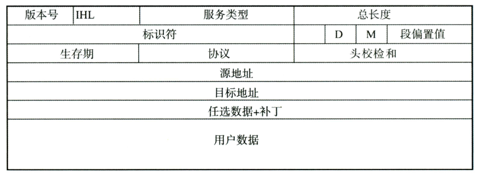

• 版本号：协议的版本号，不同版本的协议格式或语义可能不同，现在常用的是1Pv4,  
正在逐渐过渡到IPV6。  
• IHL: IP 头长度，以 32位宇计数， 最小为 5，即 20个字节。  
服务类型：用于区分不同的可靠性、优先级、延迟和吞吐率的参数。  
•总长度：包含IP头在内的数据单元的总长度（宇节数）  
•标识符：唯一标识数据报的标识符。  
•标志： 包括3个标志， 一个是M标志，用于分段和重装配； 另一个是禁止分段标志，  
如果认为目标站不具备重装配能力，则可使这个标志置位，这样如果数据报要经过一  
个最大分组长度较小的网络， 就会被丢弃， 因而最好使用源路由以避免这种灾难发生；  
第3个标志当前没有启用。  
•段偏置值： 指明该段处于原来数据报中的位置。  
•生存期：用经过的路由器个数表示。  
•协议： 上层协议（TCP或UDP） 。  
•头校检和：对IP头的校验序列。在数据报传输过程中IP头中的某些字段可能改变（例  
如生存期，以及与分段有关的宇段） ， 所以校检和要在每一个经过的路由器中进行校  
验和重新计算。 校检和是对IP头中的所有 16位字进行1的补码相加得到的，计算时  
假定校检和字段本身为0。  
•源地址： 给网络和主机地址分别分配若干位， 例如7和24、 14和 16、 21 和8等。  
•目标地址： 同上。  
•任选数据： 可变长，包含发送者想要发送的任何数据。  
•补丁： 补齐32位的边界。  
•用户数据：以宇节为单位的用户数据，和IP头加在一起的长度不超过65535字节。

### IP 地址与子网划分

IP 网络地址采用 “网络·主机”的形式，其中网络部分是网络的地址编码， 主机部分是网 络中一个主机的地址编码。 IP地址的格式如图所示

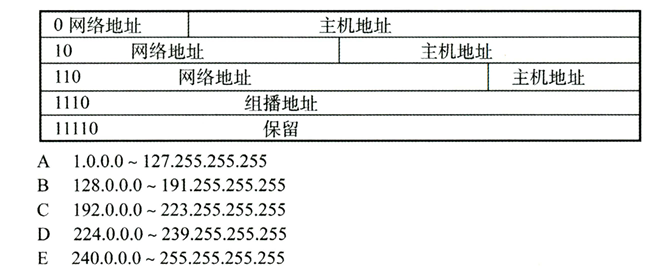  
IP 地址分为5类。 A类、 B类、 C类是常用地址。 IP地址的编码规定全0表示本地地址， 即本地网络或本地主机： 全l表示广播地址，任何网站都能接收。 所以，除去全0和全l地址 外， A类有 126个网络地址， 1600万个主机地址： B类有 16382个网络地址， 64000个主机地 址： C类有200万个网络地址， 254个主机地址。  
IP 地址通常用十进制数表示，即把整个地址划分为4个字节， 每个字节用一个十进制数表示，中间用圆点分隔。根据IP地址的第一个字节， 就可判断它是A类、 B类还是C类地址。 子网划分把主机地址部分再划分为子网地址和主机地址，形成了三级寻址结构。 这种三级寻址方式需要子网掩码的支持  
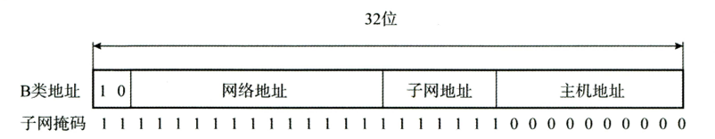  
子网地址对网络外部是透明的。当IP分组到达目标网络后，网络边界路由器把32位的IP 地址与子网掩码进行逻辑“与”运算，从而得到子网地址，并据此转发到适当的子网中。 图所示为B类网络地址被划分为两个子网的情况  
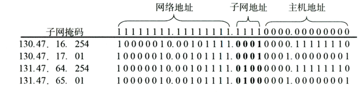  
虽然子网掩码是对网络编址的有益补充，但是还存在着一些缺陷。 例如，一个组织有几个 包含 25 台左右计算机的子网，又有一些只包含几台计算机的较小的子网。在这种情况下，如果将一个C类地址分成6个子网，每个子网可以包含30 台计算机，大的子网基本上利用了全部地址，但是小的子网却浪费了许多地址。为了解决这个问题，避免任何可能的地址浪费，就 出现了可变长子网掩码（Variable Length Subnetwork Mask, VLSM）的编址方案。这样，可以 在IP 地址后面加上“／位数”来表示子网掩码中“1”的个数。例如， 202.117.125.0/27 的前 27 位表示网络号和子网号，即子网掩码为27位长， 主机地址为5位长。

### IPv6 协议

IPv6 协议的特点  
•更大的地址空间。 IPv6 将地址从 IPv4 的 32bit 增大到了 128bit  
•扩展的地址层次结构。  
•灵活的首部格式。  
•改进的选项。  
•增强安全性。  
•对QoS支持。  
IPv6 地址 IPv6 将 128 bit 地址空间分为两大部分， 如图所示。第一部分是可变长度的类型前缀， 它定义了地址的目的。 第二部分是地址的其他部分， 其长度也是可变的

!\[\](/img/网络规划设计师/(IPv6地址格式.png)

每个 16bit 的值用十六进制值表示， 各值之间用冒号分隔。  
IPv6 数据报的目的地址可以是以下三种基本类型地址之一：  
•单播 (unicast)。 单播就是传统的点对点通信。  
•多播 (multicast） 。 多播是一点对多点的通信。  
•任播 (anycast） 。 这是 IPv6 增加的一种类型。 任播的目的站是一组计算机， 但数据报在交付时只交付给其中的一个，通常是距离最近的一个。  
前缀为 0000 0000 是保留一小部分地址与 IPv4 兼容的，这是因为必须要考虑在比较长的时期， IPv4 和 IPv6 将会同时存在，而有的结点不支持 IPv6  
IPv6 扩展了地址的分级概念，使用以下三个等级：  
**•第一级（顶级)，指明全球都知道的公共拓扑。**  
**•第二级（地点级)，指明单个的地点。**  
**•第三级，指明单个的网络接口。**  
IPv6 报文格式 IPv6 数据报首部格式如图所示。  
IPv6 数据报各字段说明如下。  
IPv6 的基本首部， 具体包括：  
•版本（version) : 4 bit，它指明了协议的版本，对 IPv6 该字段总是 6。  
•流量类型 (Traffic Class) : 8 bit，这是为了区分不同的 IPv6 数据报的类别或优先级。  
•流标签 (Flow Label) : 20bit，用于源节点标识IPv6 路由器需要特殊处理的包序列。  
•载荷长度（Payload Length) : 16 bit，它指明 IPv6 数据报除基本首部以外的字节数 （所有扩展首部都算在有效载荷之内） ， 其最大值是 64KB。  
• 下个首部（NextHead) : 8 bit。 它相当于 IPv4 的协议字段或可选字段。  
• 跳数限制 （HopLimit) : 8 bit。源站在数据报发出时即设定跳数限制。 路由器在转发 数据报时将跳数限制宇段中的值减1。 当跳数限制的值为零时， 就要将此数据报丢弃。  
• 源地址（SourceAddress) : 128bit， 指明生成数据包的主机的 IPv6 地址。  
•目的地址（Destination Address) : 128bit， 指明数据包最终要到达的目的主机的 IPv6 地址。  
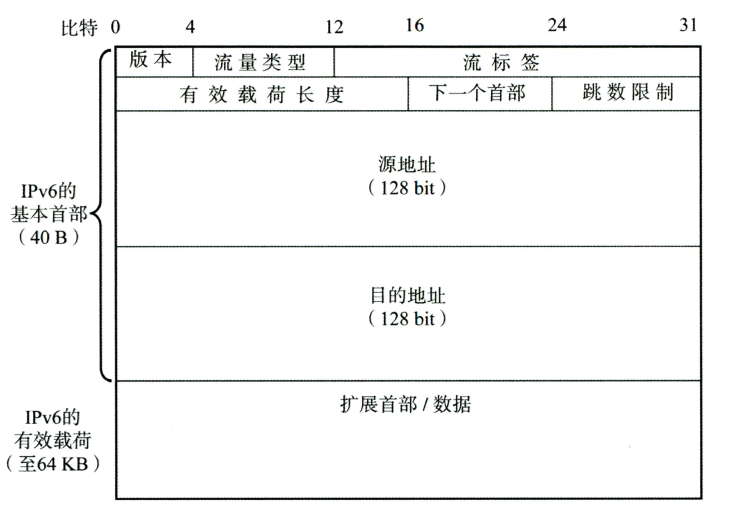  
(2) IPv6 的扩展首部。 IPv6 将原来 IPv4 首部中选项的功能都放在扩展首部中，并将扩展 首部留给路径两端的源站和目的站的主机来处理。数据报途中经过的路由器都不处理这些扩展 首部（只有一个首部例外，即逐跳选项扩展首部），这样就大大提高了路由器的处理效率。 在［RFC 2460］中定义了六种扩展首部：  
• 逐跳选项： 此扩展头必须紧跟在IPv6基本首部之后， 它包含所经路径上的每一个节点 都必须检查的选项数据。 由于它需要在每个中间路由器都进行处理，所以只有在绝对 必要的时候才出现。  
• 路由选择： 此扩展头指明数据包在到达目的地途中将经过的各节点的地址列表。  
• 分片： 当IPv6源地址发送的数据包比到达目的地址所经过的路径上的最小MTU还要大时， 这个数据包就要被分成几段分别发送，这时就要用到分片头。  
• 鉴别： 鉴别头的功能是实现了数据的完整性和对数据来源的认证。  
• 封装安全有效载荷： 封装安全有效载荷头提供数据加密功能，实现端到端的加密， 提 供无连接的完整性和防重发服务。封装安全有效载荷头可以单独使用， 也可以在使用 隧道模式时嵌套使用。  
• 目的站选项： 目的站选项头中携带仅需要最终目的节点检验的可选信息。 它要在IPv6 目的地址域所列的第一个目的主机上处理，也要在路由头所列的后续目的主机上处理。

### IPv6 地址自动配置

IPv6 中地址自动配置有两种方式： 有状态地址自动配置和无状态地址自动配置。当站点并  
不是特别关心主机所使用的精确地址时，只要它们是唯一的，井且是可路由的，就能使用无状  
态方式： 当站点严格控制地址分配时，就使用有状态方式。

(1）有状态地址自动配置。在这种模式下， 主机可以从服务器获得接口地址，也可以从服 务器上获得配置信息和参数。服务器中维护着一个数据库，其中记录着主机和地址分配的列表。 比较常用的是DHCPv6 (Dynamic Host Configuration Protocol for IPv6）协议， 即支持 IPv6 的动 态主机配置协议。它允许DHCPv6服务器把诸如IPv6 网络地址等信息传给1Pv6节点。DHCPv6 服务器与客户端使用UDP来交换DHCPv6报文。服务器和中继代理使用 UDP端口 547来监昕 DHCPv6 报文； 客户端使用 UDP端口 546来监听报文。

(2）无状态地址自动配置。这种模式要求本地链路支持组擂，而且网络接口能够发送和接 收组播包。 采用这种方式可以为任意主机配置一个IPv6地址，这个地址内嵌一个以太网地址， 由于以太网地址全球唯一，因此获得的IPv6地址也是唯一的。  
具体过程如下：  
首先，进行自动配置的节点必须确定自己的链路本地地址。  
然后，必须验证该链路本地地址在链路上的唯一性。  
最后，节点必须确定需要配置的信息。该信息可能是节点的 IP 地址，或者是其他配置信息， 或者两者皆有。  
具体地说， 在无状态地址自动配置过程中， 主机首先通过将它的网卡MAC地址附加在链 路本地地址前缀 1111111010 之后，产生一个链路本地单播地址 (IEEE 已经将网卡 MAC 地址 由 48 位改为了 64位。如果主机采用的网卡的MAC地址依然是48位，那么 IPv6 网卡驱动程序会根据IEEE 的一个公式将48位MAC地址转换为64位MAC地址） 。接着主机向该地址发出一个邻居发现请求（Neighbor Discovery Request），以验证地址的唯一性。 如果请求没有得到响应，则表明主机自我配置的链路本地单播地址是唯一的。否则， 主机将使用一个随机产生 的接口 ID 组成一个新的链路本地单播地址。然后，以该地址为源地址，主机向本地链路中所 有路由器多点传送一个路由器请求（Router Solicitation）来请求配置信息，路由器以一个包含一个可聚集全球单播地址前缀和其他相关配置信息的路由器宣告（Router Advertisement）作为响应。主机用它从路由器得到的全球地址前缀加上自己的接口 ID，自动配置全球地址，然后就可以与Internet 中的其他主机通信了。

如果本地网络孤立于其他网络，则节点必须寻找配置服务器来完成其配置：否则，节点必须侦听路由器宣告报文。这些报文周期性地发往所有主机的组播地址，以指明诸如网络地址和子网地址等配置信息。 节点可以等待路由器宣告，也可以通过发送组播请求给所有路由器的组播地址来请求路由器发送宣告。 一旦收到路由器的响应，节点就可以使用响应的信息来完成自动配置。

### 邻节点发现过程

邻居发现协议使用一系列的 IPv6 控制信息报文来实现相邻节点的信息交互管理，井在一 个子网中保持网络层地址和链路层地址之间的映射。邻居发现协议中定义了 5种类型的信息： 路由器宣告、路由器请求、路由重定向、 邻居请求和邻居宣告。 邻节点发现过程具体如下：  
①路由器发现：即帮助主机来识别本地路由器。  
②前缀发现： 节点使用此机制来确定指明链路本地地址的地址前缀以及必须发送给路由 器转发的地址前缀。  
③参数发现： 帮助节点确定诸如本地链路MTU之类的信息。  
④地址自动配置： 用于IPv6节点自动配置。  
⑤地址解析： 替代了ARP和RARP， 帮助节点从目的IP地址中确定本地节点（即邻居） 的链路层地址。  
⑥下一跳确定： 可用于确定包的下一个目的地，即可确定包的目的地是否在本地链路上。 如果在本地链路，下一跳就是目的地；否则，包需要选路，下一跳就是路由器，邻居发现可用 于确定应使用的路由器。  
⑦邻居不可达检测： 帮助节点确定邻居（目的节点或路由器）是否可达。 ③ 重复地址检测： 帮助节点确定它想使用的地址在本地链路上是否己被占用。 ⑨重定向： 有时节点选择的转发路由器对于待转发的包而言并非最佳。 这种情况下，该 转发路由器可以对节点进行重定向， 使它将包发送给更佳的路由器。

### ICMP 协议

ICMP (Internet Control Message Protocol) 与 IP 协议同属于网络层， 用于传送有关通信问 题的消息，例如数据报不能到达目标站，路由器没有足够的缓存空间， 或者路由器向发送主机 提供最短通路信息等。 ICMP报文封装在IP数据报中传送， 因而不保证可靠的提交。 ICMP报文有 11 种之多，报文格式如图所示。 其中， 类型字段表示ICMP报文的类型：代码字段可表示报文的少量参数： 当参数较多时写入32位的参数字段： ICMP报文携带的信息包含在可变长的信息字段中；校验和宇段是关于整个ICMP报文的校验和。  
  
报文包括以下类型：  
• 目标不可到达(类型 3) ：如果路由器判断出不能把IP数据报送达目标主机，则向源主机返回这种报文。 另一种情况是目标主机找不到有关的用户协议或上层服务访问点，也会返回这种报文。 出现这种情况的原因可能是IP头中的字段不正确：或者是数据报中说明 的源路由无效：也可能是路由器必须把数据报分段，但IP头中的D标志己置位。  
• 超时（类型 11 ）：路由器发现 IP 数据报的生存期已超时，或者目标主机在一定时间内无法完成重装配，则向源端返回这种报文。  
• 源抑制（类型4) ： 这种报文提供了一种流量控制的初等方式。如果路由器或目标主机缓冲资源耗尽而必须丢弃数据报，则每丢弃一个数据报就向源主机发回一个源抑制报文，这时源主机必须减小发送速度。 另外一种情况是系统的缓冲区已用完， 并预感到行将发生拥塞，则发出源抑制报文。 但是与前一种情况不同，涉及的数据报尚能提 交给目标主机。  
• 参数问题（类型 12）：如果路由器或主机判断出 IP 头中的字段或语义出错，则返回这种报文，报文头中包含一个指向出错字段的指针。  
• 路由重定向（类型 5）：路由器向直接相连的主机发出这种报文，告诉主机一个更短的路径。 例如路由器R1 收到本地网络上主机发来的数据报， Rl检查它的路由表， 发 现要把数据报发往网络X，必须先转发给路由器R2，而R2又与源主机在同一网络中， 于是R1 向源主机发出路由重定向报文，把R2的地址告诉它。  
• 回声 （请求／响应，类型8/0） ： 用于测试两个节点之间的通信线路是否畅通。收到回声 请求的节点必须发出回声响应报文。该报文中的标识符和序列号用于匹配请求和响应报文。当连续发出回声请求时，序列号连续递增。 常用的PING工具就是这样工作的。  
• 时间戳（请求／响应， 类型 13/14）：用于测试两个节点之间的通信延迟时间。请求方发出本地的发送时间，响应方返回自己的接收时间和发送时间。 这种应答过程如果结合强制路由的数据报实现，则可以测量出指定线路上的通信延迟。  
• 地址掩码（请求／响应，类型 17/18）：主机可以利用这种报文获得它所在的LAN的子网掩码。 首先主机广播地址掩码请求报文，同一 LAN上的路由器以地址掩码响应报文回答，告诉请求方需要的子网掩码。了解子网掩码可以判断出数据报的目标节点与源节点是否在同一LAN中

### ARP 协议

IP 地址是分配给主机的逻辑地址，在因特网络中表示唯一的主机。 似乎有了 IP地址就可以方便地访问某个子网中的某个主机，寻址问题就解决了。其实不然，还必须考虑主机的物理地址问题。  
由于互连的各个子网可能源于不同的组织，运行不同的协议（异构性），因而可能采用不同的编址方法。任何子网中的主机至少都有一个在子网内部唯一的地址，这种地址都是在子网建立时一次性指定的， 甚至可能是与网络硬件相关的，我们把这个地址叫作主机的物理地址或 硬件地址。  
物理地址和逻辑地址的区别可以从两个角度看：从网络互连的角度看，逻辑地址在整个因特网络中有效，而物理地址只是在子网内部有效；从网络协议分层的角度看，逻辑地址由 Internet 层使用，而物理地址由子网访问子层（具体地说就是数据链路层）使用。 由于有两种主机地址， 因此需要一种映像关系把这两种地址对应起来。在 Internet 中是用地址分解协议（Address Resolution Protocol, ARP ） 来实现逻辑地址到物理地址映像的。

### ARP 分组格式

ARP 分组的格式如图所示，各字段的含义解释如下。  
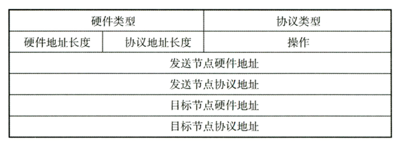  
• 硬件类型： 网络接口硬件的类型，对以太网此值为 1。  
•协议类型： 发送方使用的协议， 0800H表示IP协议。  
•硬件地址长度： 对以太网，地址长度为6字节。  
•协议地址长度： 对IP协议，地址长度为4字节。

操作：  
1 ARP 请求  
2 ARP 响应  
3 RARP 请求  
4 RARP 响应  
通常， Internet 应用程序把要发送的报文交给 IP, IP 协议当然知道接收方的逻辑地址（否则就不能通信了） ， 但不一定知道接收方的物理地址。在把IP分组向下传送给本地数据链路实体之前，可以用两种方法得到目标物理地址。  
(1)查本地内存的 ARP地址映像表，通常ARP地址映像表的逻辑结构如表所示。可以看出这是IP地址和以太网地址的对照表。  

( 2）如果ARP表查不到，就广播一个ARP请求分组， 这种分组可经过路由器进一步转发， 到达所有连网的主机。它的含义是： “如果你的IP地址是这个分组的目标地址，请回答你的物理地址是什么。 ”收到该分组的主机一方面可以用分组中的两个源地址更新自己的ARP地址映像表： 另一方面用自己的IP地址与目标IP地址宇段比较， 若相符则发回一个ARP响应分组， 向发送方报告自己的硬件地址， 若不相符则不予回答。

### 代理ARP

所谓代理ARP (Proxy ARP） ， 就是路由器“假装”目标主机来回答ARP请求， 所以源主机必须先把数据帧发给路由器，再由路由器转发给目标主机。这种技术不需要配置默认网关， 也不需要配置路由信息，就可以实现子网之间的通信。用于说明代理ARP的例子如图所示， 设子网A上的主机A (172.16.10.100）需要与子网B上的主机D (172.16.20.200）通信。  
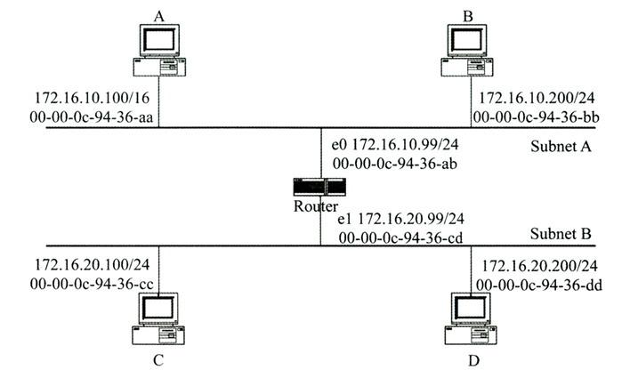  
图中的主机A有一个16位的子网掩码，这意味着主机A认为它直接连接到网络172.16.0.0。 当主机A需要与它直接连接的设备通信时，它就向目标发送一个ARP请求。 当主机A需要主机D的MAC地址时， 它在子网A上广播的ARP请求分组如下  
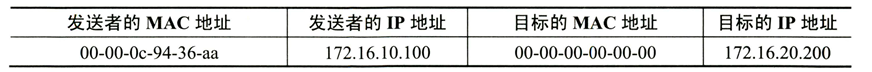  
这个请求的含义是要求主机D (172.16.20.200） 回答它的 MAC 地址。 ARP 请求分组被包装在以太帧中，其源地址是A的MAC地址，而目标地址是广播地址 （FFFF.FFFF.FFFF） 。 由于路由器不转发广播帧，所以这个ARP请求只能在子网A中传播，到不了主机D。如果路由器知道目标地址（172.16.20.200）在另外一个子网中，它就以自己的 MAC 地址回答主机 A,路由器发送的应答分组如下。  
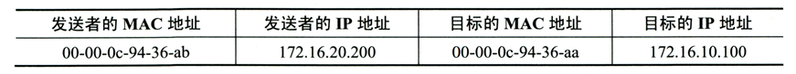  
这个应答分组封装在以太帧中， 以路由器的MAC地址为源地址， 以主机A的MAC地址为目标地址， ARP应答帧是单播传送的。在接收到ARP应答后，主机A就将它的ARP表更新如下。  

从此以后，主机A就把所有给主机D(172.16.20.200）的分组发送给MAC地址为 00-00-0c-94-36-ab 的主机， 这就是路由器的网卡地址。 通过这种方式，子网A中的ARP映像表都把路由器的MAC地址当作子网B中主机的MAC 地址。 例如，主机A的ARP映像表如下。

  
多个IP地址被映像到一个MAC地址这一事实正是代理ARP的标志。  
RARP (Reverse Address Resolution Protocol）是反向 ARP 协议，即由硬件地址查找逻辑地址。 通常， 主机的E地址保存在硬盘上，机器关电时也不会丢失，系统启动时自动读入内存中。但是， 无盘工作站无法保存E地址， 它的E地址由RARP服务器保存。当无盘工作站启动时， 广播一个 RARP请求分组，把自己的硬件地址同时写入发送方和接收方的硬件地址字段中。 RARP服务器接 收这个请求，并填写目标IP地址字段，把操作字段改为RARP响应分组，送回请求的主机。

### 路由协议

因特网由不同的自治系统互连而成。自治系统内采用内部网关协议（Interior Gateway Protocol, IGP）进行路由选择，可能选择不同的路由表、 不同的路由选择算法。在不同自治系统之间用外部网关协议（Exterior Gateway Protocol, EGP）交换路由信息。 例如若干个校园网 通过广域网互连就是这种情况，如图所示。常用内部路由协议包括路由信息协议（Routing Information Protocol, RIP）、开放最短路径优先协议（Open Shortest Path First, OSPF）、中间系统到中间系统的协议 (IntermediateSystem to Intermediate System, IS-IS）、内部网关路由协 议（Interior Gateway Routing Protocol, IGRP）和增强的 IGRP 协议 （Enhanced IGRP, EIGRP）。 外部网关协议有BGP协议。  
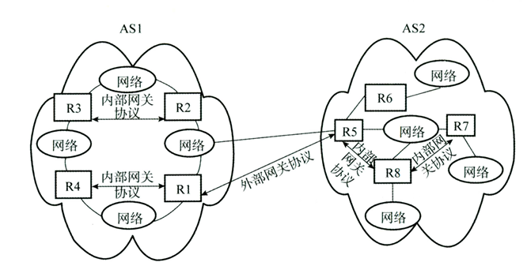

### 路由信息协议（RIP)

RIP 是一种分布式的基于距离向量的路由选择协议。 该协议定义距离就是经过的路由器的数目， 距离最短的路由就是最好的路由。它允许一条路径最多只能包含 15 个路由器（限制了 网络的规模） 。 距离的最大值为 16 时即为不可达。 所以RIP 不能在两个网络之间同时使用多 条路由来进行负载均衡。  
RIP 协议要求网络中的每一个路由器都要维护从它自己到其他每一个目的网络的距离记 录，并依此来形成自己的路由表， 且按固定时间（一般为30s）和相邻路由器交换路由表。  
RIP 协议属于应用层协议，它使用传输层的用户数据报 UDP 进行传送。 RIP协议的格式 及它和UDP, IP协议的关系如图所示。  
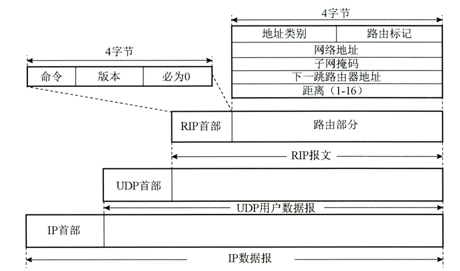  
RIP协议中的命令字段指出报文的意义。 地址类别字段指出所使用的地址协议， 当使用IP 地址时， 该字段的值为 2。 路由标记字段应该写入自治系统号。 一个RIP报文最大长度为 504 字节， 这是因为一个RIP报文的路由部分最多可包含25个路由信息。当超过504字节的最大长度时， 就应该再用一个RIP报文来传送。 RIP 的特点是： “好消息传播得快， 坏消息传播得慢。 ”它的意思是， 如果路由器发现了一个 更短的路由，这个消息可以很快得以传播； 但如果网络出现了故障， 这样的消息会传播得很慢。

### 开放最短路径优先协议（OSPF)

OSPF 协议是分布式的链路状态路由协议。链路在这里代表该路由器和哪些路由器是相邻 的， 即通过一个网络是可以连通的;链路状态说明了该通路的连通状态以及距离、时延、带宽等参数。在该协议中， 只有当链路状态发生变化时，路由器才用洪泛法向所有路由器发送路由信息。 所发送的信息是与本路由器相邻的所有路由器的链路状态。为了保存这些链路状态信息， 每个路由器都会建立一个链路状态数据库， 因为路由器交换信息时使用的是洪泛法，所以每个路由器都存有全网的链路状态信息，也就是说每个路由器都知道整个网络的连通情况和拓扑结构。这样每个路由器都可以根据链路状态数据库的信息来构造自己的路由表。 为了及时了解链路的状态情况， 每个路由器需要定期（10s）向邻居路由器发送Hello分组。 如果40秒钟还没有收到邻居的Hello信息，则认为该邻居是不连通的，应该立即修改链路状态数据库中所对应的记录，并重新计算路由表。 除了 Hello 问候分组外， OSPF 协议还有四种分组： 链路状态更新分组、 链路状态确认分组、 链路状态描述分组和链路状态请求分组。 通过这四种分组达到全网链路数据库的同步。 链路状态更新分组是正常情况下， 当链路状态发生变化时使用洪泛法所发送的分组： 链路状态确认分组是对链路状态更新分组的确认： 链路状态描述分组是当路由器启动一条新的通路时，向邻居路由器所发送的分组： 链路状态请求分组是在与邻居路由器交换了链路状态描述分组后， 还需要其他自己缺少的路由信息时所使用的分组。 OSPF 协议的格式及它与IP协议的关系如图所示。  
  
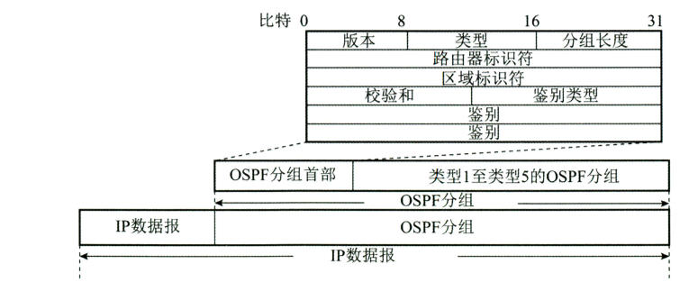  
OSPF 协议使用洪泛法向网络中所有路由器发送链路状态信息，为了减小洪泛范围， OSPF 协议对网络进行了区域划分。 这在OSPF协议首部的区域标识符宇段体现了出来

### IS-IS 路由协议

IS-IS (Intermediate System to Intermediate System，中间系统到中间系统）路由协议最初是 ISO （国际标准化组织）为 CLNP ( Connection Less Network Protocol， 无连接网络协议）设计的一种动态路由协议。为了提供对IP路由的支持， 通过对IS-IS进行扩充和修改，使IS-IS 能够同时应用在TCP/IP环境中，形成了集成化IS-IS， 用于城域网和承载网中。 IS-IS 协议也是基于链路状态并使用最短路径优先算法进行路由计算的一种 IGP 协议。 OSPF 具有多路由类型、 多区域类型、根据带宽设定开销规则、 网络类型多样等特点，多用 园区网中。 IS-IS 则具有算法快速、报文结构简便、 快速建立邻居关系以及大容量路由传递等一 系列特点，在骨干网有着天然的优势

1.路由器类型  
在IS-IS 中，路由器可以分为三种类型：Level-1(L1）路由器、Level-2(L2）路由器、Level-1-2 ( L1/2 ）路由器。  
( 1) Level-1 路由器， 特点如下：  
• L1 路由器是一个IS-IS普通区域内部的路由器， 只能在非骨干区域中存在。  
• L1 路由器只能与属于同一区域的L1 和L1/2 路由器建立L1 邻接关系（不能与L2路由器建立邻接关系） ， 交换路由信息， 并维护和管理本区域内部的一个L2 的LSDB。  
• L1 路由器的邻居都在同一个区域中， 其 LSDB 包含本区域的路由信息以及到达同一 区域中最近Ll/2 路由器（相当于 OSPF 中的 ABR）的缺省路由， 但到区域外的数据 需由最近的Ll/2 路由器进行转发。  
• 也就是说， L1 路由器只能转发区域内的报文， 或者将到达其他区域的报文转发到距离 它最近，且在同一区域的L1/2路由器。

(2) Level-2 路由器， 特点如下：  
•L2 路由器是骨干区域中的路由器，主要用于通过与普通区域中的L1/2 路由器连接，连接骨干区域和非骨干区域， 类似于OSPF网络中的BR （骨干路由器，并负责在不同区域间的通信。 L2路由器负责区域间的路由，它可以与相同或者不同区域的L2路由器或者不同区域的Ll/2路由器形成邻居关系。 L2路由器维护一个L2 的LSDB，该 LSDB 包含区域间的路由信息。 L2路由器只可能建立L2 的邻接关系。  
•网络中的所有口路由器和所有L1/2路由器连接在一起共同构成IS-IS 网络的骨干网 （注意，不是骨干区域）， 也称L2区域。 IS-IS 中的L2 区域不是一个特定的区域，是 由连接网络中各个区域的一部分路由器组成的， 但必须是连续的。

(3) Level-1-2 路由器，特点如下：  
•L1/2 路由器类似于OSPF 网络中的ABR C区域边界路由器〉，用于区域间的连接。  
•L1/2 路由器既可以与同一普通区域的L1 路由器以及其他L1/2路由器建立L1 邻接关 系，也可以与骨干区域L2路由器建立L2邻接关系。 L1 路由器必须通过L1/2路由器才能与其他区域通信。  
•L1/2 路由器必须维护以下两个LSDB: L1 LSDB 用于区域内路由， L2 LSDB用于区域间路由。 但要注意的是， L1/2路由器不一定要位于区域边界，在区域内部也有可能存在L1/2 路由器

网络分层路由域为了支持大规模的路由网络， IS-IS 在自治系统内采用骨干区域与非骨干区域两级分层结构，如图所示。一般来说，将Level-1路由器部署在非骨干区域，将Level-2路由器和Level-1-2 路由器部署在骨干区域。每一个非骨干区域都通过Level-1-2路由器与骨干区域相连。  
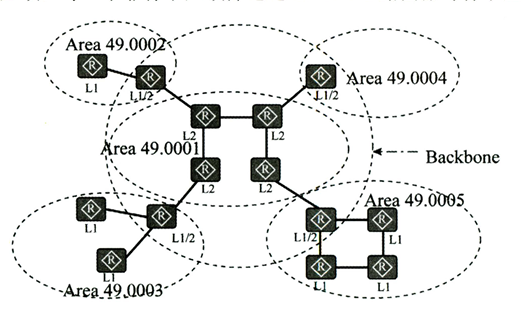

在OSPF 中， 骨干区域固定为Area0， 且非骨干区域要和骨干区域相连（没有通过物理连 接的话则要进行虚连接）。但是在IS-IS 中：  
• 可以有多个骨干区域，且区域ID不固定；  
• 非骨干区域必须和骨干区域物理相连（通过L1/2路由器)： 非骨干区域之间不能直接连接。 Level-1-2 级别的路由器可以属于不同的区域，在 Level-1区域维护Level-1的 LSDB， 在 Level-2 区域维护 Level-2 的 LSDB。  
外部网关协议（BGP) BGP 是不同自治系统的路由器之间交换路由信息的协议。由于Internet的规模太大，使得自治系统之间路由选择非常困难。 另外， 对于自治系统之间的路由选择，要寻找最佳路由是不现实的。 所以 BGP 只是尽力寻找一条能够到达目的网络且比较好的路由（不能兜圈子） ，而不像内部网关协议一样要寻找一条最佳路由。

每一个自治系统的管理员要选择至少一个路由器作为该自治系统的“BGP 发言人”。 BGP 发言人往往就是 BGP 边界路由器， 但也可以不是 BGP 边界路由器。 通常，两个 BGP 发言 人都是通过一个共享网络连接在）起的。  
当一个 BGP 发言人与其他自治系统中的 BGP 发言人交换路由信息时， 首先要建立 TCP 连接，然后在此连接上交换 BGP 报文以建立 BGP 会话（session），利用 BGP 会话 交换路由信息。  
在BGP 刚刚运行时， BGP 的邻站是交换整个的 BGP 路由表。但以后只需要在发生变化 时更新有变化的部分。 这样做对节省网络带宽和减少路由器的处理开销方面都有好处。 BGP 发言人互相交换网络可达性的信息后，各 BGP 发言人就可找出到达各自治系统的比 较好的路由。

BGP-4 共使用四种报文：  
• 打开（Open）报文，用来与相邻的另一个BGP发言人建立关系。  
• 更新（Update）报文，用来发送某一路由的信息， 以及列出要撤销的多条路由。  
• 保活（Keepalive）报文，用来确认打开报文和周期性地证实邻站关系。  
• 通知（Notification）报文，用来发送检测到的差错。  
BGP 协议的格式及它与TCP和IP协议的关系如图所示。

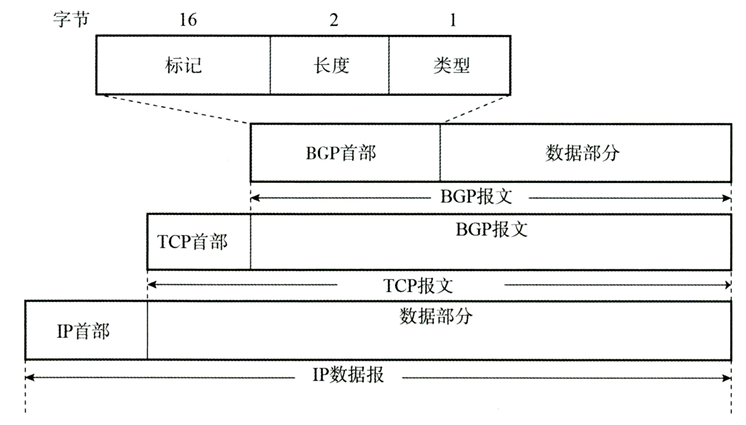

### 核心网关协议

Internet 中有一个主干网，所有的自治系统都连接到主干网上。 这样， Internet 的总体结构 如图所示，分为主干网和外围部分， 后者包含所有的自治系统。  
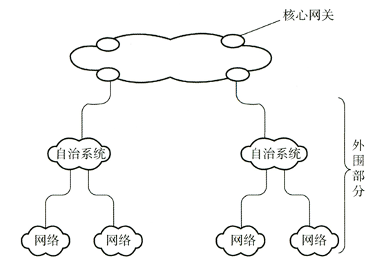  
主干网中的网关叫核心网关。核心网关之间交换路由信息时使用核心网关协议（Gatewayto Gateway Protocol, GGP)。 这里要区分 EGP 和 GGP, EGP 用于两个不同自治系统之间的网关 交换路由信息，而GGP是主干网中的网关协议。 因为主干网中的核心网关是由InterNOC直接控制的， 所以GGP更具有专用性。 当一个核心网关加入主干网时用GGP协议向邻机广播发送 路由信息，各邻机更新路由表，并进一步传播新的路由信息。  
网关交换的路由信息与 EGP 协议类似，指明网关连接哪些网络， 距离是多少，距离也是 以中间网关个数计数。 GGP协议的报文格式与EGP类似，报文分为以下4类：  
• 路由更新报文： 发送路由信息。  
• 应答报文： 对路由更新报文的应答，分肯定、否定两种。  
• 测试报文： 测试相邻网关是否存在。  
• 网络接口状态报文：测试本地网络连接的状态。

### 路由器技术

#### NAT 技术

NAT 技术主要解决 IP 地址短缺问题，最初提出的建议是在子网内部使用局部地址，而在 子网外部使用少量的全局地址，通过路由器进行内部和外部地址的转换。局部地址是在子网内部独立编址的，可以与外部地址重叠。 这种想法的基础是，假定在任何时候，子网中只有少数计算机需要与外部通信，可以让这些计算机共享少量的全局IP地址。后来根据这种技术叉开发 出其他一些应用，下面介绍两种最主要的应用。

第一种应用是动态地址翻译（Dynamic Address Translation）。为此首先引入存根域（Stub Domain）的概念。所谓存根域，就是内部网络的抽象，这样的网络只处理源和目标都在子网内部的通信。任何时候，存根域内只有一部分主机要与外界通信，甚至还有许多主机可能从不与外界通信，所以整个存根域只需共享少量的全局IP地址。 存根域有一个边界路由器，由它来处理域内主机与外部网络的通信。 在此做以下假定：  
m： 需要翻译的内部地址数。  
n：可用的全局地址数（NAT地址）  
当 m:n 翻译满足条件（$m \geq 1$且$m\geq n$） 时，可以把一个大的地址空间映像到一个小的地址空间。所有NAT地址放在二个缓冲区中，并在存根域的边界路由器中建立一个局部地址和全局地址的动态映像表，如图所示。 这个图显示的是把所有B类网络 138.201.0.0 中的IP地 址翻译成C类网络 178.201.112.0 中的 IP 地址。  
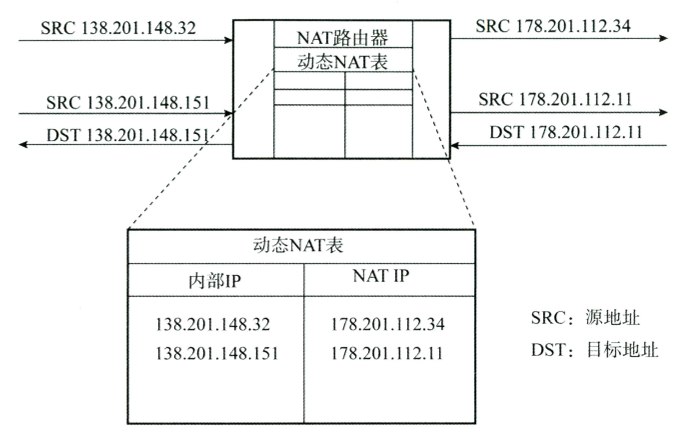  
这种NAT地址重用有以下特点：  
• 只要缓冲区中存在尚未使用的C类地址，任何从内向外的连接请求都可以得到响应， 并且在边界路由器的动态NAT表为之建立一个映像表项。  
• 如果内部主机的映像存在，可以利用它建立连接。  
• 从外部访问内部主机是有条件的，即动态NAT表中必须存在该主机的映像。动态地址翻译的好处是节约了全局 IP 地址，而且不需要改变子网内部的任何配置， 只需在边界路由器中设置一个动态地址变换表就可以工作了。

另外一种特殊的NAT应用是$m:1$翻译，这种技术也叫作伪装 （Masquerading） ， 因为 用一个路由器的IP地址可以把子网中所有主机的IP地址都隐藏起来。 如果子网中有多个主机 同时都要通信，那么还要对端口号进行翻译，所以这种技术经常被称为网络地址和端口翻译 ( Network Address Port Translation, NAPT)。在很多 NAPT 实现中专门保留一部分端口号给伪装使用，叫作伪装端口号。图中的NAT路由器中有一个伪装表，通过这个表对端口号进行翻译，从而隐藏了内部网络 138.201.0.0 中的所有主机。  
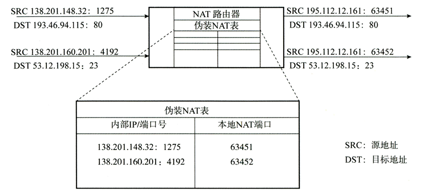  
可以看出，这种方法有以下特点  
• 出口分组的源地址被路由器的外部IP地址所代替，出口分组的源端口号被一个未使用的伪装端口号所代替。  
• 如果进来的分组的目标地址是本地路由器的IP地址，而目标端口号是路由器的伪装端口号，则NAT路由器就检查该分组是否为当前的一个伪装会话，并试图通过伪装表对 IP 地址和端口号进行翻译。  
伪装技术可以作为一种安全手段使用，借以限制外部网络对内部主机的访问。 另外，还可 以用这种技术实现虚拟主机和虚拟路由，以便达到负载均衡和提高可靠性的目的。

#### IP 组播技术

在 IP 组播模式下，组播源无须知道所有的组成员，组播树的构建是由接收者驱动的，是由最接近接收者的网络节点完成的，这样建立的组播树可以扩展到很大的范围。 有人形容 IP 组播模型是：你在一端注入分组，网络正好可以把分组提交给任何需要的接收者。 组播成员可以来自不同的物理网络。 组播技术的有效性在于，在把一个组播分组提交给所 有组播成员时， 只有与该组有关的中间节点可以复制分组， 在通往各个组成员的网络链路上只传送分组一个副本。 所以利用组播技术可以提高网络传输的效率，减少主干网拥塞的可能性。  
组播地址  
通常有两种组播地址： 一种是 IP 组播地址：另一种是以太网组播地址。 IP 组播地址在互 联网中标识一个组，把IP组播数据报封装到以太帧中时要把IP组播地址映像到以太网的MAC 地址，其映像方式是把IP地址的低23位复制到MAC地址的低23位，如图所示。  
  
IPv4 的 D 类地址是组播地址，用作一个组的标识符，其地址范围是224.0.0.0～ 239.255.255.255。 按照约定， D类地址被划分为 3 类：

• 224.0.0.0～224.0.0.255： 保留地址，用于路由协议或其他下层拓扑发现协议以及维护 管理协议等，例如224.0.0.1 代表本地子网中的所有主机， 224.0.0.2代表本地子网中的 所有路由器， 224.0.0.5 代表所有 OSPF 路由器， 224.0.0.9 代表所有 RIP 2 路由器， 224.0.0. 12 代表 DHCP 服务器或中继代理， 224.0.0.13 代表所有支持PIM的路由器等。

• 224.0.1.0～238.255.255.255：用于全球范围的组播地址分配，可以把这个范围的 D 类 地址动态地分配给一个组播组，当一个组播会话停止时， 其地址被收回，以后还可以 分配给新出现的组播组。

• 239.0.0.0～239.255.255.255：在管理权限范围内使用的组措地址，限制了组播的范围， 可以在本地子网中作为组播地址使用。

为了避免使用ARP协议进行地址分解， IANA （互联网数字分配机构）保留了一个以太网 地址块 Ox0100.5EOO.OOOO 用 于映像 IP 组播地址，其中第 1 个字节的最低位是 1/G ( Individual/Group），应设置为 “1”，以表示以太网组擂，所以 MAC 组播地址的范围是0x0100.5E00.0000~ 0x0100.5E7F.FFFF。

按照这种地址映像方式， IP地址的5位被忽略，因而造成了 32个不同的组播地址对应于 同一个MAC地址， 产生地址重叠现象。 例如，考虑表所示的两个D类地址， 由于最后的 23 位是相同的，所以会被映像为同一个MAC地址0x0100.5E1A.0A05

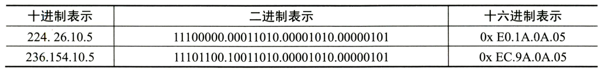  
虽然从数学上说，可能有32个IP组播地址会产生重叠，但是在现实中却是很少发生的。 即使不幸出现了地址重叠情况，其影响就是有的站收到了不期望接收的组播分组，这比所有站 都收到了组播分组的情况要好得多。在设计组播系统时要尽量避免多个IP组播地址对应同一个MAC 地址的情况出现，同时，用户在收到组播以太帧时，要通过软件检查IP源地址字段， 以确定是否为期望接收的组插源的地址。  
因特网组管理协议  
IGMP ( Internet Group Management Protocol ）是在 IPv4 环境中提供组管理的协议，参加组播的主机和路由器利用IGMP交换组播成员资格信息，以支持主机加入或离开组播组。 在IPv6 环境中，组管理协议已经合并到ICMPv6协议中， 不再需要单独的组管理协议。 RFC3376 定义了 IGMPv3 成员资格询问和报告报文， 也定义了组记录的格式， IGMP报文封装在IP数据报中传输。

成员资格询问报文由组插路由器发出， 分为3种子类型：  
• 通用询问： 路由器用于了解在它连接的网络上有哪些组的成员。  
• 组专用询问： 路由器用于了解在它连接的网络上一个具体的组是否有成员。  
• 组和源专用询问： 路由器用于了解它所连接的主机是否愿意加入一个特定的组。

#### 第三层交换

所谓第三层交换， 是指利用第二层交换的高带宽和低延迟优势尽快地传送网络层分组的技 术。 交换与路由不同， 前者用硬件实现， 速度快，而后者由软件实现，速度慢。 三层交换机的 工作原理可以概括为： 一次路由，多次交换。也就是说，当三层交换机第一次收到一个数据包时必须通过路由功能寻找转发端口， 同时记住目标MAC 地址和源 MAC 地址，以及其他有关信息， 当再次收到目标地址和源地址相同的帧时就直接进行交换，不再调用路由功能。所以， 三层交换机不但具有路由功能， 而且比通常的路由器转发得更快。

IETF （互联网工程任务组）开发的多协议标记交换（Multi-Protocol Label Switching, MPLS) 把第2层的链路状态信息（带宽、延迟、利用率等）集成到第3层的协议数据单元中， 从而简化和改进了第3层分组的交换过程。 理论上， MPLS支持任何第2层和第3层协议。 MPLS包头的位置界于第2层和第3层之间，可称为第2.5层，标准格式如图所示。 MPLS可以承载的报文通常是IP包，当然也可以直接承载以太帧、 AAL5包，甚至ATM信元等。 承载MPLS 的第2层协议可以是PPP、以太帧、 ATM和帧中继等，如图所示

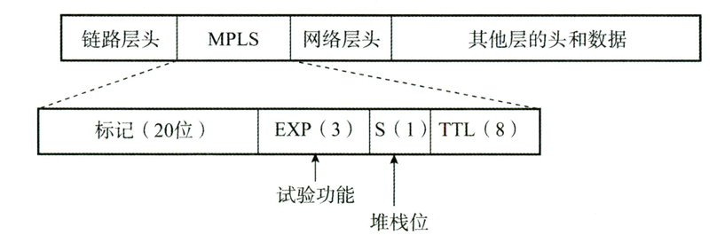  
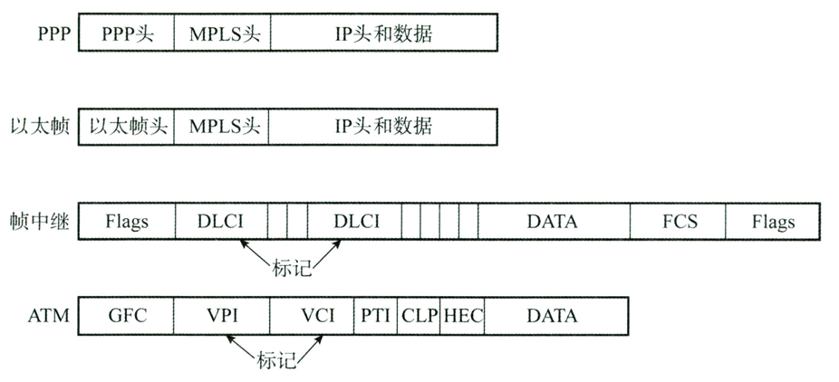  
当分组进入MPLS 网络时，标记边缘路由器（Label Edge Router, LER）就为其加上一个 标记，这种标记不仅包含了路由表项中的信息（目标地址、带宽和延迟等），而且还引用了IP 头中的源地址字段、 传输层端口号和服务质量等。 这种分类一旦建立， 分组就被指定到对应的 标记交换通路（Label Switch Path, LSP）中，标记交换路由器（Label Switch Router, LSR）将 根据标记来处置分组， 不再经过第3层转发， 从而加快了网络的传输速度。  
MPLS 可以把多个通信流汇聚成为一个转发等价类（ForwardingEquivalence Class, FEC）。 LER 根据目标地址和端口号把分组指派到一个等价类中， 在LSR 中只需根据等价类标记查找标 记信息库（Labellnfonnation Base, LIB），确定下一跳的转发地址，这样使得协议更具伸缩性。  
MPLS 标记具有局部性， 一个标记只是在一定的传输域中有效。 在图中， 有A、 B、 C三个传输域和两层路由。 在A域和C域内， IP包的标记找只有一层标记L1； 而在B域内， IP 包的标记战中有两层标记L1和L2。 LSR4收到来自 LSR3 的数据包后，将L1层的标记换成 目标LSR7 的路由值，同时在标记枝增加一层标记L2，称为入栈。在B域内，只需根据标记校 的最上层L2标记进行交换即可。 LSR7收到来自 LSR6 的数据包后， 应首先将数据包最上层的 L2 标记弹出， 其下层L1标记变成最上层标记， 称为出栈，然后在C域中进行路由处理。  
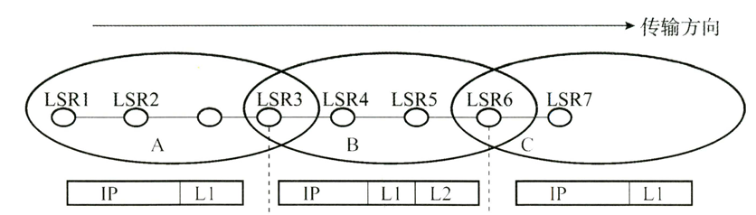  
MPLS 转发处理简单， 提供显式路由， 能进行业务规划，提供QoS保障，提供多种分类粒 度，用一种转发方式实现各种业务的转发。与IP over ATM技术相比， MPLS具有可扩展性强、兼容性好、易于管理等优点。但是， 如何寻找最短路径， 如何管理每条LSP 的 QoS 特性等技术问题还在讨论之中。
